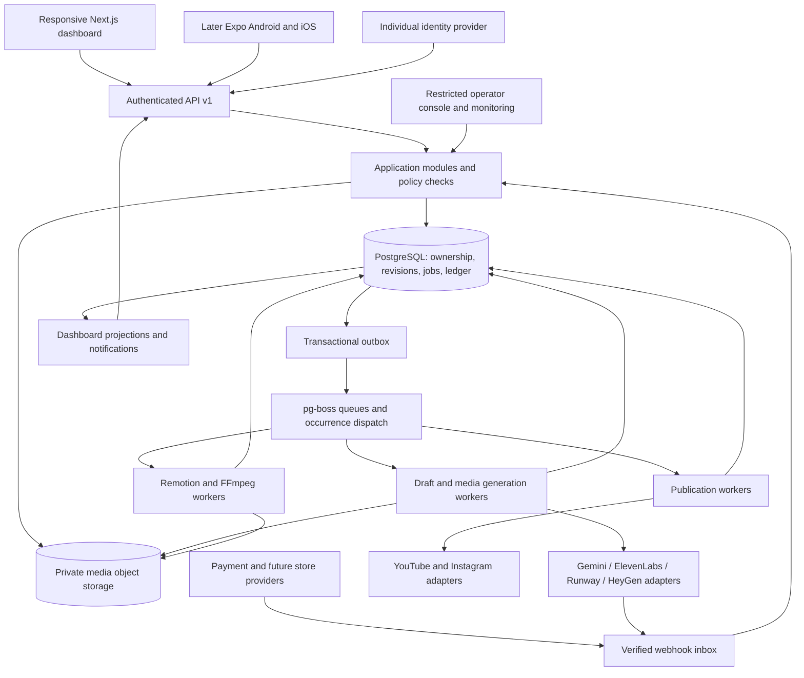
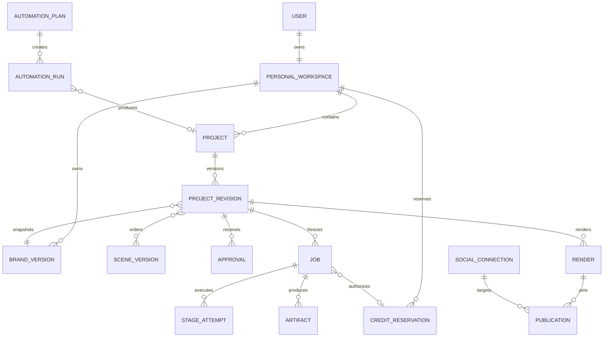
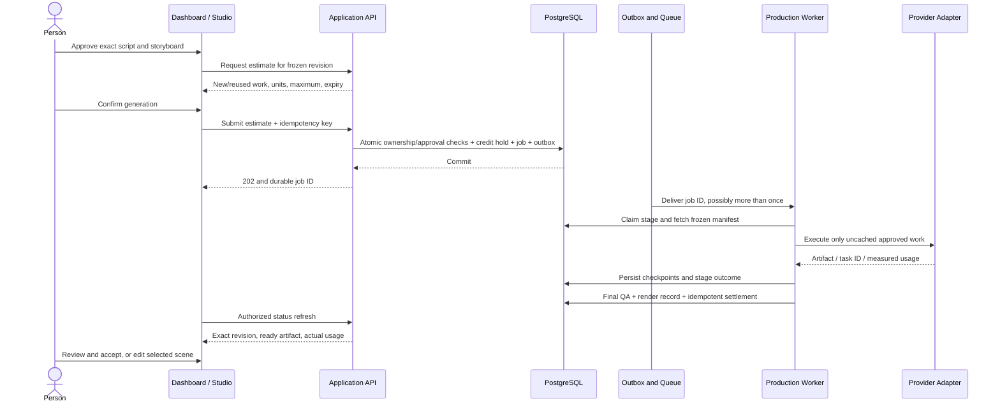

# V1 Dashboard — System Design and Architecture

Document version: 1.0  
Date: October 27, 2026 (Asia/Calcutta)  
Status: Design for review and implementation planning. This document is not an implementation or verification report.  
Product: AI Educational Video Studio; final name and domain remain undecided.  
Baseline: [PRD v1.2](PRD.md), [V1/V2 roadmap](product-roadmap.md), [cross-platform plan](cross-platform-implementation-plan.md), and subsequent product decisions in this conversation.

Detailed implementation-design companions: [V1 API contracts](api-design-v1.md) and [V1 database design](database-design-v1.md). They expand this architecture's endpoint/data outline into proposed wire contracts, table dictionaries and transactional rules; no implementation or migration is implied.

## Contents

1. [Purpose and scope](#1-purpose-and-scope)
2. [Confirmed decisions and assumptions](#2-confirmed-decisions-and-assumptions)
3. [V1 capability and release map](#3-v1-capability-and-release-map)
4. [Information architecture](#4-information-architecture)
5. [Dashboard home and project experience](#5-dashboard-home-and-project-experience)
6. [Studio and supporting screens](#6-studio-and-supporting-screens)
7. [System architecture](#7-system-architecture)
8. [Frontend architecture](#8-frontend-architecture)
9. [Application service boundaries](#9-application-service-boundaries)
10. [Data architecture](#10-data-architecture)
11. [API contracts](#11-api-contracts)
12. [Creation and generation flow](#12-creation-and-generation-flow)
13. [State, revisions and recovery](#13-state-revisions-and-recovery)
14. [Video styles, audio and media](#14-video-styles-audio-and-media)
15. [Billing, credits, INR and USD](#15-billing-credits-inr-and-usd)
16. [Connections, calendar and publishing](#16-connections-calendar-and-publishing)
17. [Recurring plans and automation](#17-recurring-plans-and-automation)
18. [Security, privacy and deletion](#18-security-privacy-and-deletion)
19. [Notifications, analytics and operations](#19-notifications-analytics-and-operations)
20. [Performance and reliability](#20-performance-and-reliability)
21. [Deployment and delivery](#21-deployment-and-delivery)
22. [Verification and acceptance](#22-verification-and-acceptance)
23. [PRD traceability](#23-prd-traceability)
24. [Open decisions and risk register](#24-open-decisions-and-risk-register)
25. [References and evidence boundaries](#25-references-and-evidence-boundaries)

## 1. Purpose and scope

Design the authenticated customer dashboard and the systems required to make every V1 dashboard action work. The dashboard includes the creative studio, projects, brand settings, jobs, usage/billing, social connections, calendar, recurring workflows, notifications, settings and help. It is more than a landing page or a grid of video thumbnails.

The product helps one person turn source material into a reviewed, branded 30–90-second educational video, revise individual scenes, export it, then schedule and automate publication through later V1 milestones. Educator, creator and brand use cases share one interface and ownership model; onboarding preferences personalize suggestions.

**V1 includes F01–F16 across R0–R4.** R1 creation, R2 paid launch, R3 publishing and R4 automation are delivery milestones within V1. Publishing and automation are not being moved to V2. The first paid launch can occur at R2 while R3/R4 remain scheduled work.

**Latest product additions:** users can choose 2D character explainers, cinematic/story clips and realistic presenters. These choices were requested after the written PRD, which excludes cinematic generation as the default and face avatars from its first-launch baseline. This design covers all three as explicit V1 extensions, C01–C03, while keeping the original motion-only format. They require a tracked PRD addendum before implementation; this document does not silently rewrite the PRD.

The customer interface is individual: no team setup, group login, shared seats, client spaces, invitations or external reviewers in V1. Agency collaboration remains [V2](PRD-V2-agency.md). Landscape/square output, a general multitrack editor, model training, voice cloning, multilingual guarantees and advanced social performance analytics remain outside this design's V1 commitment.

## 2. Confirmed decisions and assumptions

| ID | Decision | Design consequence |
|---|---|---|
| D01 | One individual login and private personal workspace | One owner boundary; no customer role/member UI or workspace switcher |
| D02 | Support both INR and USD | Versioned price books, explicit billing currency, currency-safe invoices and refunds |
| D03 | Responsive website first; Android/iOS staged | Next.js web delivery first; versioned APIs and reusable domain contracts from the beginning |
| D04 | Three selectable character/video styles | Style capability service, provider adapters, distinct estimates and quality gates |
| D05 | Educational/source-based V1 direction | Source confirmation, references, review flags and exact-version approvals throughout |
| D06 | 30/60/90-second, English, vertical 9:16 baseline | 1080×1920, 30 fps H.264/AAC; measured runtime tolerance ±10% |
| D07 | Human review is the default | Draft generation does not imply render or publishing approval |
| D08 | Gemini, ElevenLabs, Runway and HeyGen are current integration choices | App-owned server credentials; provider-independent project records |
| D09 | Existing prototype is a foundation | Prototype media/evidence are separate from dashboard, queue, billing and recovery acceptance |
| D10 | Code changes require separate user permission | This task creates documentation only; no application code, migrations, provider calls or deployment changes |

D02 and D03 were confirmed while preparing this document. Currency choice does not change the initial English content requirement. The customer can select an IANA timezone; INR does not imply Asia/Kolkata and USD does not imply an American timezone.

Proposed implementation choices, rather than additional product promises: a modular backend, PostgreSQL/pg-boss, transactional outbox, private object storage, polling before optional realtime, feature-gated rollout, and one active subscription per personal workspace. Final prices, credit allowances, payment provider, tax treatment and worker sizing remain open.

## 3. V1 capability and release map

| Milestone | Required customer-facing capabilities | Backend dependency | Gate |
|---|---|---|---|
| R0 | Reference previews and production proofs | Templates, voice, captions, provider feasibility, media validation | Output quality and measured cost; early social access investigation |
| R1 | F01–F12: personal account, brand, sources, ideas, script, storyboard, motion video, voice, captions, scene edits, preview/export, projects/dashboard | Identity, ownership, versions, private media, durable jobs, status and recovery | Complete real-source creation with private pilot users |
| R2 | F13: subscriptions, usage, estimates, invoices, credit history, support | Atomic ledger, purchase webhooks, hardened workers, operator tools | Paid journey, isolation, recovery and refund/reconciliation checks |
| R3 | F14–F15: connections, calendar, publish now, scheduling, destination status | OAuth, encrypted tokens, publication workers, remote reconciliation | Supported account/permission tests and independently verified remote outcomes |
| R4 | F16: topic plans, recurring drafts, notifications, bounded opt-in auto-publishing | Versioned policies, occurrence scheduler, budgets, deduplication and pause controls | No duplicate runs, policy bypasses or unbounded spending |
| C01–C03 within V1 | 2D characters, cinematic clips, realistic presenters | Asset catalogs, additional provider contracts, mode-specific QA and cost benchmarks | Enable each customer mode only after its capability and commercial gates pass |

The release plan must state which additional styles are available on the first paid website launch. The confirmed target is all three in V1; no untested mode is advertised as working. A disabled mode explains availability and cannot submit a paid request. R1/R2 scope for baseline features remains independently traceable.

Document ingestion and optional generated visual assets are PRD P1 capabilities, not replacements for the required topic/notes/script/public-URL inputs. Their interfaces can be reserved without making them a prerequisite for R1.

## 4. Information architecture

Paths below are proposed application routes, not assertions that these pages already exist.

| Area | Proposed route | Contents / principal action | Availability |
|---|---|---|---|
| Account entry | `/login`, `/signup`, `/recover` | Individual sign-in, signup, recovery | R1 |
| Personal onboarding | `/onboarding` | Audience/use case, timezone, optional brand, processing disclosure | R1 |
| Home | `/dashboard` | Continue work, create video, attention queue, recent projects | R1 |
| Projects | `/projects` | Search, status/style/duration filters, duplicate, archive, delete | R1 |
| New video | `/projects/new` | Source, objective, audience, duration, style | R1; styles gated |
| Studio | `/projects/:id/studio` | Brief, ideas, script, storyboard, generation, review, export | R1 |
| Versions | `/projects/:id/versions` | Earlier drafts, accepted renders, explicit restore | R1 |
| Job detail | `/jobs/:id` | Durable stage, retained work, failure/recovery/cancel | R1 |
| Brand | `/brand` | Logo, colors, font, tone, voice, closing message and sample | R1 |
| Usage | `/usage` | Generation history; available/reserved/spent units and storage | Instrument in R1; customer billing detail R2 |
| Billing | `/billing` | Currency, plan, checkout/portal, invoices, payment states | R2 |
| Connections | `/connections` | Destination identity, supported capabilities, health/reconnect | R3 |
| Calendar | `/calendar` | Month/week/list views, platform-specific publication jobs | R3 |
| Automations | `/automations`, `/automations/:id` | Rolling topic plan, policies, runs, spending, pause/resume | R4 |
| Notifications | `/notifications` | Review requests, completed work, failures and budget/account issues | R1 onward |
| Settings/help | `/settings`, `/help` | Personal defaults, currency policy, privacy/deletion, support | R1 onward |
| Internal operations | Restricted internal surface | Queue/provider/payment/publication diagnostics and audited interventions | Before R2; separate staff authorization |

Sidebar: Home, Projects, Brand, Calendar, Connections, Automations, Usage & Billing, Settings, Help. Show release-gated areas only when relevant; future marketing information must not resemble an available action. Studio is contextual to a project. On phones, use a compact navigation menu and a small primary tab set instead of reproducing a full desktop sidebar.

## 5. Dashboard home and project experience

### 5.1 Home composition

| Region | Data | Customer action | Guardrail |
|---|---|---|---|
| Header | Personal profile, notifications, connection/save health where relevant | New video; account menu | No team creation or member invitations |
| Continue working | Most recently edited non-archived project, exact saved stage/revision | Resume at the saved step | An older render never replaces a newer draft |
| Needs attention | Review flags, failed jobs, stale approvals, connection or budget blocks | Open the precise recovery/review screen | Rank actionable items above ordinary history |
| Production queue | Active jobs with queued/running stage and elapsed/last-update timestamps | Inspect; request cancel | Persisted server state; no invented whole-job percent/ETA |
| Recent projects | Thumbnail, title, duration, style, edited time, draft/render state | Open, duplicate, archive, delete | Paginated, owner-scoped results; meaningful empty state |
| Usage summary | Available units, reserved units, renewal date and selected currency context | Inspect usage/billing | Fetch ledger-derived values; loading is not a zero balance |
| Publishing summary | Upcoming destination jobs and reconnection issues | Open calendar/job | Added R3; counts are destinations, not unique videos |
| Recurring summary | Next occurrences, paused plans, review backlog and budget headroom | Review/pause a plan | Added R4; pause does not silently cancel an already executing action |

Cards are optional layout components, not separate microservices. Avoid follower counts, impressions, engagement predictions or fabricated savings; advanced social analytics are not a V1 feature. An unconnected account produces a setup action rather than a misleading zero metric.

Desktop structure:

```text
Navigation | New video                              Notifications / Account
           | Continue working             Needs attention
           | Active generation jobs       Available / reserved usage
           | Recent projects: search, status, style, sort
           | Upcoming publication / recurring work when enabled
```

Mobile priority: New video → Continue → Needs attention → Active jobs → Recent projects → usage/publication summaries. Keep generation status accessible without requiring the studio to remain open.

### 5.2 Project read model

Each project summary includes `id`, title, target and measured duration when available, current revision, current editorial stage, style, last edit, thumbnail artifact identity, latest job summary, current accepted render and preview freshness. Thumbnail URLs are short-lived authorized responses, not permanent public object keys.

Search initially uses indexed title/brief text; source-body search is optional and privacy-scoped. Filters and sort are encoded in the URL. Use cursor pagination with a proposed page size of 20 and a deterministic secondary ID sort; do not load every project or render manifest on dashboard entry. Lists support draft, needs review, producing, ready and archived filters while retaining the richer underlying states in Section 13.

Duplication creates new project/version identities and clears approvals, publication jobs and usage reservations. It may refer to existing authorized immutable assets through reference records; it never duplicates historical charges. Restoring an old version creates a new current revision. Archive is reversible; deletion uses the lifecycle in Section 18.

## 6. Studio and supporting screens

### 6.1 Creative studio

| Step | Required content and controls | Completion rule |
|---|---|---|
| Source / brief | Topic, notes, script or public article URL; audience, learning objective, tone, duration, optional CTA and style | Imported text is confirmed; provenance and source version persisted |
| Ideas | Around five distinct angles with problem, outcome, hook and rationale; select/edit/save/dismiss or enter own | Selection updates brief without dropping sources; regeneration is explicit |
| Script | Sections, editable narration, estimated speech length, source references, uncertain claims and section rewrite | Approval targets an exact script revision; flagged content remains visible |
| Storyboard | Purpose, narration, display text, template, visual description, estimated timing; reorder/add/delete/duplicate | Exact storyboard revision approved; supported mode/template/actions validated |
| Production setup | Voice and permitted rate/pauses/pronunciation, caption style, logo/brand snapshot, optional cleared music, mode-specific character/presenter settings | Show affected assets, provider capability and current estimate before generation |
| Generation | Stage, queued time, elapsed time, completed work, cancellation and recovery | Durable job state; browser closure has no execution effect |
| Review / edit | Complete player, scene navigation, caption controls, sources, pronunciation and scene edits | Changes show stale output and request an explicit updated preview |
| Ready / export | Accept exact render, MP4, thumbnail and SRT; historical versions and secure-link renewal | Media QA passed and exact render identity visible; export is not publication |

Six baseline template families remain required: title/hook, process, comparison, concept diagram, statistic with context/source, and recap/CTA. Scene-count guidance remains 4–6 / 6–9 / 8–12 for 30 / 60 / 90 seconds, with pacing prioritized. A character overlay is an additional scene element, not a reason to remove these explanatory templates.

Desktop can show scene list, preview and controls together. Mobile web must support all creation actions with one scene at a time, tabs/stacked panels, usable keyboards, explicit move-up/down controls and safe sticky actions. Dragging and hover are optional enhancements. Separate display text from pronunciation text; caption edits do not silently rewrite speech.

### 6.2 Supporting screens

- **Brand:** validate logo type/size, approved fonts and colors; save tone/audience/voice/CTA defaults; preview on a sample; apply a new brand to an existing project only through an explicit revision. Curated music/visual assets retain usage-rights records.
- **Usage/billing:** accessible history of estimates, reservations, settled/refunded units, payment status, invoices, pricing currency and plan changes. A credit balance and a currency amount are different quantities.
- **Settings:** email/recovery via auth provider, timezone, language support, use-case defaults, notification choices, sign-out, privacy/processing consent and account deletion request. Customer API-key entry is not part of the default V1 product.
- **Help:** contextual recovery guidance, supported inputs/accounts/formats, usage/refund rules and support request with safe correlation IDs. Attachments containing customer content need an explicit upload action.
- **Notifications:** unread state, action link, associated project/job/publication and event time. Dismiss/read actions never mutate approval or execution state.

## 7. System architecture

Use one modular application backend with independent worker processes. Separate deployments for long work provide resource isolation; a service-per-page architecture is unnecessary.



Proposed technology responsibilities:

| Layer | Choice | Boundary |
|---|---|---|
| Responsive client and initial API | Existing Next.js/React/TypeScript scaffold | UI, authentication/session boundary, validated application endpoints |
| Shared contracts/domain | Existing TypeScript workspace packages, extended deliberately | DTO schemas, validation, revision rules, price/credit types and API client |
| Identity and relational data | Supabase Auth and PostgreSQL | Personal ownership, source/version records, durable application state |
| Queue | pg-boss plus application outbox | Delivery/retries/scheduling; application idempotency protects effects |
| Production | Remotion/FFmpeg workers; provider adapters | Scene assets, measured audio/captions, final encode and technical QA |
| Media | Private object-storage adapter; R2 or Supabase Storage selected after deployment evaluation | Authorized upload/download, checksums and lifecycle |
| Payments | Provider-neutral payment module; provider unresolved | Web checkout/portal and verified entitlement events |
| Native later | Expo/React Native | Separate touch UI sharing identity, APIs and domain rules |
| Observability | Structured logs, metrics, traces, error/alert provider selected before R2 | Safe correlation IDs, queues, cost and recovery visibility |

Supabase publishable and secret keys have different access implications, and RLS is part of the data boundary. The backend/worker must still enforce ownership explicitly when using privileged credentials. [Supabase API keys](https://supabase.com/docs/guides/getting-started/api-keys), [row-level security](https://supabase.com/docs/guides/database/postgres/row-level-security).

The outbox, financial ledger, projections and provider-effect reconciliation are proposed application architecture. They are not guarantees supplied automatically by the queue library. [pg-boss](https://github.com/timgit/pg-boss) supplies PostgreSQL job primitives; design every external effect to tolerate repeated delivery.

## 8. Frontend architecture

### 8.1 Composition and state ownership

Use a protected application shell for navigation/session context, page-level read queries and small interactive client components. The studio maintains an editable local draft while immutable versions and job state remain server-owned. The renderer and provider SDKs are not imported into dashboard client bundles.

| State | Authority | Client behavior |
|---|---|---|
| Session/identity | Auth provider, verified by server | Restore/refresh securely; expired session preserves unsaved text for safe reauthentication |
| Projects, revisions, approvals, job state | Database/application API | Query/cache by current user and resource; revalidate after mutations |
| Credits, subscription, capabilities | Server | Never decide balance, entitlement or provider eligibility solely in UI |
| In-progress editor text | Local draft until acknowledged | Debounced autosave, visible status, conflict handling; no false saved badge |
| Filters, selected studio step, tabs | URL plus local UI state | Shareable navigation and reliable back/forward; no secrets in URL |
| Signed media links | Authorized API response with expiry | Renew on expiry; refresh links without regenerating assets |

Private dashboard data must not enter a cross-user HTTP/CDN cache. Server/client caches include the authenticated account/resource boundary, are cleared on logout/account switch and revalidate entitlement after purchases. A worker event is a refresh signal; authorized API data remains the source of truth.

### 8.2 Dashboard query contract

`GET /api/v1/dashboard` returns a bounded summary: recent projects, next resumable item, attention items, active jobs, ledger summary and enabled-module summaries. It includes `asOf`, per-section availability/error status and cursor links for drill-down. A failed billing query must not hide projects; a missing connection summary must not display as zero scheduled posts. Expensive video manifests and source text are loaded only when opening the project.

Initial progress transport is periodic polling, proposed around 3 seconds for active jobs, slowing when idle/backgrounded and refetching on focus/reconnect. Optional authorized SSE/realtime and native push can reduce latency later. Limit open subscriptions and poll concurrency; a disconnected client never owns job execution.

Accessibility follows the PRD's WCAG 2.2 AA target for application controls: semantic headings/labels, keyboard and visible focus, contrast, accessible progress announcements and touch targets. Reduced-motion preferences govern application animation without silently changing an approved exported video. Test desktop browsers, iOS Safari and Android Chrome; emulated narrow Chromium screens do not establish device/browser coverage. Use readable caption/video-safe areas independently of dashboard CSS.

### 8.3 Autosave and conflicts

Start autosave within 2 seconds after an editing pause. Serialize writes for a draft and attach an `expectedRevisionId`/version. The server atomically creates a revision and advances the head. On conflict, preserve local text, retrieve latest, and offer compare/reapply; do not silently merge semantic changes or overwrite another device. Leave navigation with unsaved work clearly signposted. Offline support is draft preservation and resumable operations, not offline generation or billing.

## 9. Application service boundaries

| Module | Responsibilities | Main owned data |
|---|---|---|
| Identity/preferences | Personal onboarding, default settings, ownership resolution, deletion request | Profiles, personal workspaces, preferences |
| Projects/versions | Brief, source attachment, current head, duplicate/archive/restore | Projects, revisions, source/brand references |
| Ingestion | Public URL extraction, uploads, provenance, user confirmation | Source versions/blocks, upload sessions, assets |
| Creative drafting | Ideas, script sections, grounded storyboard, review flags | Ideas, script/storyboard versions, provider attempts |
| Approval/policy | Exact-version script/storyboard/render/publication decisions | Approval events, policy versions, content flags |
| Capabilities/catalogs | Allowed modes, templates, rigs, voices, durations, prices and provider health | Versioned catalogs, feature flags, eligibility rules |
| Production | Estimate/preflight, frozen manifest, stage dispatch, artifact reuse, final QA | Jobs, stages, artifact/render manifests |
| Financial/entitlements | Price books, purchase lifecycle, atomic credit holds and settlement | Credit lots/reservations, immutable ledger, subscriptions, payment events |
| Publishing | Destination authorization, metadata, scheduling, upload/process/reconcile | Social connections, publication approvals/jobs/attempts |
| Automation | Topic plan, occurrence deduplication, policy/budgets, pause/cancel | Plans, versions, occurrences, runs, spend reservations |
| Dashboard/notifications | Owner-scoped summaries, attention ranking, event delivery | Read projections, notifications, delivery attempts |
| Operations/audit | Restricted diagnostics, eligible recovery, reconciliations and flags | Audit records, operator actions, alerts |

Route handlers translate authentication, validation and HTTP responses. Business transactions and policies live in application modules usable from HTTP, queue consumers and future native clients. Database schema boundaries do not require separate databases or network services.

## 10. Data architecture

### 10.1 Main records

All customer-owned records carry `workspace_id`. Resolve that ID from the verified individual identity, never from a client claim alone. Server-generated UUIDs identify persisted entities; version numbers aid display but immutable IDs/hashes bind execution.

| Record family | Principal fields and invariants |
|---|---|
| `profiles`, `personal_workspaces`, `preferences` | Auth user, one unique owner, audience/use case, IANA timezone, English support, currency preference and lifecycle |
| `brand_kits`, `brand_versions` | Current default; immutable logo/font/color/voice/tone/CTA snapshots; asset provenance |
| `projects`, `project_revisions` | Title, brief, duration, mode, current head, archive/deletion state; revision references exact source/script/storyboard/brand/assets |
| `sources`, `source_versions`, `source_blocks` | Origin URL/type, retrieved/confirmed times, extracted text, blocks, hashes and processing consent context |
| `ideas`, `script_versions`, `storyboard_versions`, `scene_versions` | Selected angles, narration/display text, source references, review flags, stable scene IDs, order and mode-specific settings |
| `catalog_versions`, `capability_flags` | Supported templates, character rigs/actions, voice/provider mappings, mode limits and compatible renderer/schema versions |
| `assets`, `artifact_references` | Private object key, checksum, detected MIME/dimensions/duration, provenance/rights, owning workspace and dependency references |
| `scene_artifacts`, `renders`, `runtime_manifests` | Audio/captions/visuals, actual timing/frame schedule, encoded output and QA; immutable dependency hashes |
| `approvals`, `approval_revocations` | Actor, scope, exact target ID/hash, time, policy version where applicable; no generic approved boolean |
| `jobs`, `job_stages`, `stage_attempts`, `job_outbox` | Operation identity, frozen manifest, states, leases/heartbeats, idempotency/body hash, attempt budget and durable dispatch |
| `estimates`, `credit_lots`, `credit_reservations`, `usage_ledger` | Bound operation/revision, integer units, expiry and retry policy; purchase/allowance origin, holds and idempotent settlement |
| `price_books`, `subscriptions`, `payment_events`, `purchase_receipts` | INR/USD price IDs and minor-unit amounts, billing currency, provider/store reference, immutable event identity and entitlement reconciliation |
| `provider_attempts`, `provider_usage` | Provider/model/voice version, safe correlation ID, outcome certainty, metering and cost reconciliation status |
| `social_connections`, `publication_versions`, `publications`, `publication_attempts` | Exact destination/capabilities, encrypted credential reference, approved render/metadata, UTC instant, remote IDs and state |
| `automation_plans`, `automation_versions`, `occurrences`, `automation_runs`, `budget_reservations` | Source/brand/policy references, cadence/timezone, dedupe key, control epoch and bounded spend |
| `notifications`, `notification_deliveries`, `audit_events` | Owner, event/deduplication identity, safe content, deep link, delivery/read state and sensitive-action audit |
| `deletion_requests`, `object_tombstones`, `webhook_inbox` | Lifecycle, execution holds, cleanup/reconciliation state, verified provider event and processing outcome |

PRD's future membership concept does not activate team roles in V1. Staff authorization belongs to a separate internal boundary; staff are not members of customer workspaces by default.



The diagram omits junctions for readability. Multiple sources and immutable asset references require explicit junction tables, not comma-separated foreign keys. A job may reuse artifacts without creating them again. A render is tied to a complete immutable runtime manifest.

### 10.2 Required constraints and indexes

- Unique workspace owner per user; ownership checks for every child record and cross-resource reference. Use composite foreign keys including `workspace_id` where feasible.
- Unique `(workspace_id, operation, idempotency_key)` plus request hash; mismatched bodies produce a conflict.
- Unique outbox dispatch key, stage claim key, ledger settlement key, verified payment event identity and notification event/channel key.
- Unique `(automation_plan_id, occurrence_key)` and provider-specific publication operation identity. A unique remote post ID is useful once known; it cannot by itself prevent the first uncertain duplicate upload.
- Immutable source/version/artifact/approval/ledger records. Replacements and reversals append new records; deletion lifecycle is a controlled exception for customer content.
- Index projects by workspace/status/updated time/ID; jobs by workspace/state/update time; due publications by state/scheduled UTC; occurrences by plan/due instant; notifications by owner/read/time; ledger by workspace/creation/ID.
- Lists and read projections never scan full source bodies or media blobs. Test representative query plans before expanding concurrency.

Object-storage writes and database transactions are not atomic together. Upload to a temporary/unreferenced object, validate bytes/hash, then publish the artifact record transactionally. A cleanup task removes abandoned objects only after checking that no active job or immutable reference needs them.

## 11. API contracts

All customer APIs are under `/api/v1`. Examples below are proposed contracts. Web and future native clients call the same application operations. Every resource query/mutation verifies the current individual and workspace ownership. Provider callbacks use their own verification path and do not inherit customer authorization from a payload.

| Method / path | Result and invariant |
|---|---|
| `GET /me`; `PATCH /me/preferences` | Profile, personal workspace, timezone, currency preference and authoritative entitlement summary |
| `GET /capabilities`; `GET /catalogs/:kind` | Enabled modes/templates/voices/rigs and versioned compatible settings; no provider secrets |
| `GET /dashboard` | Bounded owner-scoped summary with per-section health/as-of metadata |
| `GET /projects`; `POST /projects` | Cursor-based list; create validated brief and initial revision |
| `GET /projects/:id`; `PATCH /projects/:id` | Metadata/current revision; optimistic mutation using `expectedRevisionId` |
| `POST /projects/:id/duplicate`; `POST /projects/:id/archive` | New identity without approvals; reversible archive/unarchive |
| `DELETE /projects/:id` | Tombstone and asynchronous cleanup; return lifecycle state rather than claiming immediate erasure |
| `GET /projects/:id/versions`; `POST /projects/:id/restores` | List immutable versions; restore creates a new head |
| `POST /projects/:id/sources`; `POST /projects/:id/imports` | Store confirmed text or queue guarded URL extraction; retain provenance |
| `POST /source-versions/:id/confirm` | Confirm exact extracted text/hash before downstream drafting |
| `POST /uploads`; `POST /uploads/:id/complete` | Authorized bounded transfer and decoded-byte validation; uploaded does not mean usable |
| `GET /brand`; `POST /brand/versions`; `POST /projects/:id/apply-brand` | Personal defaults and explicit project snapshot update |
| `POST /projects/:id/drafts`; `PATCH /projects/:id/scenes/:sceneId` | Explicit idea/script/storyboard/rewrite operation; billable drafts require an accepted bound estimate; scene mutation creates a revision |
| `POST /projects/:id/approvals`; `POST /approvals/:id/revocations` | Exact scoped approval/revocation with dependency validation and actor audit |
| `POST /projects/:id/estimates` | Operation, revision/settings hash, reused/new work, units, maximum, expiry and cancellation/refund treatment |
| `POST /projects/:id/jobs`; `GET /jobs/:id` | Durable accepted job ID; persisted stage, version, outcome, retained work and recovery action |
| `POST /jobs/:id/cancel`; `POST /jobs/:id/recovery-estimate` | Idempotent cancellation intent; policy-bound recovery estimate before any new billable work |
| `GET /projects/:id/renders`; `POST /renders/:id/accept` | Exact historical/current render identity and user acceptance; accepting is separate from publishing approval |
| `POST /artifacts/:id/download` | Authorize a short-lived download/stream response; renew without generation |
| `GET /usage`; `GET /billing/summary`; `GET /billing/prices` | Paginated ledger and versioned INR/USD price options; correct unavailable/loading states |
| `POST /billing/checkout`; `POST /billing/portal` | Server-selected allowed price/provider return URLs; no client-supplied arbitrary amount |
| `GET /billing/invoices`; `POST /billing/currency-change` | Immutable invoice currency; preview controlled future subscription transition |
| `GET /connections`; `POST /connections/:platform/authorize` | Destination metadata and one-time authorization initiation |
| `GET /oauth/:platform/callback`; `DELETE /connections/:id` | Verify state/binding and secure token handling; disconnect/revoke appropriately |
| `GET /publications`; `POST /publications` | Owner calendar query; validated draft targeting fixed render and destination |
| `POST /publications/:id/approve`; `POST /publications/:id/schedule` | Approve exact metadata/artifact; durable UTC schedule with eligibility checks |
| `POST /publications/:id/reschedule`; `POST /publications/:id/cancel` | Expected version, approval validity and execution cutoff enforced |
| `GET /automations`; `POST /automations`; `PATCH /automations/:id` | Rolling topic plan and immutable policy versions with expected version |
| `POST /automations/:id/pause`; `POST /automations/:id/resume` | Control epoch and future-dispatch semantics; current runs shown separately |
| `GET /automations/:id/runs`; `POST /automation-runs/:id/cancel` | Occurrence/run history; safe-boundary cancel without implicit refund promises |
| `GET /notifications`; `POST /notifications/:id/read` | Paginated private alerts and read state |
| `POST /support/requests`; `POST /account/deletion-requests` | Safe support context; explicit account lifecycle request |
| `POST /webhooks/:provider` | Verify signature/authentication, persist inbox, dedupe, process asynchronously |

### 11.1 Request and response rules

Billable submissions carry `Idempotency-Key`, `estimateId`, exact revision/settings identity and accepted maximum units. A matching retry returns the original operation/result; the same key with a different body returns `409 IDEMPOTENCY_MISMATCH`. Estimates expire and are invalidated by material input/price/capability changes. A provider switch requires a new estimate/consent when it changes processing terms or permitted spending.

Asynchronous submissions return `202` only after durable application state/outbox commit. Response includes `jobId`, operation, revision, state and authorized status route. An HTTP acknowledgement is not a completed video or public post.

Use `401` for expired/missing identity, ownership-safe `404` for inaccessible resources, `409` for version/idempotency conflicts, `422` for unsupported inputs/approval/capability/entitlement rules and `429` for rate/concurrency limits. Client errors include safe `code`, `message`, `requestId`, `retryable`, `nextAction` and relevant latest revision or retained artifacts. Never return provider tokens, raw authorization headers or unfiltered provider payloads.

Web session mutations require secure cookie/session handling and request-forgery protection. Native sessions use verified tokens stored through the appropriate secure device facility. Repeated mobile requests use the same operation identity and follow the same server entitlement rules.

## 12. Creation and generation flow



Pipeline: validate frozen inputs → source/script/scene semantic checks → generate necessary narration/visuals → measure audio/align captions → schedule scene frames → compose → encode → decode/media QA → private artifact registration → financial settlement → notification. Draft generation is its own operation with source references and a review result, not an automatically approved production manifest.

Keep display wording and spoken pronunciation separate. Actual decoded audio and pauses determine timing. If speech cannot fit the duration tolerance intelligibly, preserve generated work, stop final dispatch and request a rewrite/timing decision. Never truncate speech or add arbitrary filler merely to meet a selected duration.

A final MP4 can require full re-encoding after one scene changes. Reuse unchanged narration/visual artifacts, expose new/reused work in the estimate, and do not regenerate unrelated assets merely because the output container is rebuilt.

## 13. State, revisions and recovery

### 13.1 Separate state dimensions

| Dimension | Example states | Meaning |
|---|---|---|
| Editorial head | brief, script draft/approved, storyboard draft/approved, review, ready | Current customer draft and its exact approval state |
| Production job | queued, running, awaiting review, retry pending, succeeded, failed, cancel requested, cancelled | Execution of one frozen operation |
| Preview/render freshness | none, preparing, current, earlier revision, invalid | Whether displayed media reflects the current head and passed QA |
| Project lifecycle | active, archived, deletion requested, deleting, deleted | Visibility and permitted future work |
| Publication | draft, awaiting approval, scheduled, uploading, processing, published, needs reconnection, retry pending, failed, cancelled, outcome uncertain | A destination-specific operation |
| Subscription | pending, active, delinquent/grace, cancelled at term, expired, revoked | Provider-normalized entitlement state under the approved policy |
| Automation | draft, active, paused by owner, paused by policy, archived | Eligibility to dispatch future occurrences |

The project card uses a documented projection of these dimensions, not one mutable status that loses information. Example: “New draft saved; earlier accepted video available; narration running” is valid. Production success never implies customer acceptance, and upload success never implies public publication.

### 13.2 Dependency invalidation

| Change | Invalidate/recompute | Preserve |
|---|---|---|
| Source content | Dependent review/approval validity; require editorial decision | Historical sources, approved exports and evidence |
| Narration/pronunciation | Affected scene audio/alignment, frame offsets and composition | Unchanged scenes and visual assets |
| Display text/caption style | Relevant layout/composition; timing if caption wording changes | Speech when spoken words are unchanged |
| Scene order/hold | Global schedule/caption offsets/composition | Existing valid audio/visual assets |
| Brand colors/font/logo | Applied project version and composition | Voice unless explicitly changed; previous renders |
| Character/pose/visual | Affected visual preparation/composition | Unchanged narration/alignment |
| Voice/provider setting | Affected audio or provider clips and dependent captions/timing | Other compatible assets and immutable history |
| Publishing metadata/destination/time | Publication version and approval where required | Fixed render unless user explicitly selects another |

Scheduled publications pin a render ID and metadata version. Editing a project does not swap their media. A later safety/rights revocation may block dispatch and require review, but must not silently replace the approved artifact.

### 13.3 Recovery behavior

Workers process queue messages at least once. Stage claims, external-operation journals and financial uniqueness constraints prevent repeated delivery from repeating effects. Heartbeats/leases and deadlines distinguish a crashed worker from a healthy slow task; reclaim only after checking the persisted stage/provider/artifact outcome. Initial heartbeat/lease values may start around 15/90 seconds and must be tuned to observed workloads.

Attach a monotonic claim/fencing token to each stage attempt and compare it when checkpointing/finalizing or initiating another external effect. A worker that lost its lease cannot overwrite a newer claimant's state. An already in-flight provider call cannot be undone by a database fence: persist request intent and use provider idempotency/task lookup where supported; otherwise reconcile or require intervention before another paid call. This is an application-level correctness requirement, not a claim of exactly-once network delivery.

| Failure/event | System response | Dashboard response / charge behavior |
|---|---|---|
| Double-click or request resend | Reuse idempotent accepted operation | Same job and credit hold; no duplicate charge |
| Refresh, logout or app suspension | Server job continues independently | Resume from persisted state after authentication |
| Local save/network failure | Preserve unacknowledged draft; do not claim saved | Visible retry; compare if server revision advanced |
| Worker stops after artifact upload | Verify checkpoint/checksum; reuse completed work | Recovered stage and original operation identity |
| Temporary provider error | Bounded backoff/jitter and retry budget | Accurate stage/retry state; customer policy shown |
| Provider timeout after possible billing | Reconcile task/request status; no blind new paid request | Outcome uncertain / needs attention; retain work and usage uncertainty |
| Invalid AI/template/asset/permission | Fail or bounded repair path; permanent errors do not loop | Actionable input/review correction |
| Storage write fails after paid generation | Retry storing retained intermediate; do not repeat generation automatically | Explain retained work and recovery status |
| Audio too long or alignment uncertain | Await review; release unused holds under settlement policy | Rewrite/timing/review action; no fake ready output |
| Cancel while running | Record intent; stop new stages at safe boundary; reconcile in-flight effects | Requested versus completed cancellation distinguished; incurred work disclosed |
| Another revision completes first | Keep both histories; never overwrite current head | Earlier-version badge and update-preview action |
| Expired media link | Reauthorize link for existing object | Resume preview/download without generation |
| Payment webhook repeats/out of order | Verify, dedupe and reconcile provider state | No duplicate grant; pending/reconciled entitlement is visible |
| Ambiguous social upload | Reconcile remote IDs/status before retry | Outcome uncertain; no “Published” claim until verified |

Terminal settlement releases unspent reservations exactly once. Internal retries and covered provider errors must follow the published refund policy without duplicate customer charges. A new user-requested regeneration receives a fresh estimate; a covered recovery is not silently converted into another purchase. Operator recovery uses the same application policy paths and is audited.

## 14. Video styles, audio and media

### 14.1 Style-specific production

| Mode | Editor controls | Generation path | Extra acceptance gates |
|---|---|---|---|
| Motion / 2D character explainer | Baseline templates; optional curated character, action/expression, position, props/background | Owned/licensed vectors/rigs + frame-driven animation + scene narration + Remotion | Consistent rig, readable diagrams, bounded actions, caption safe areas and optional lip-sync accuracy |
| Cinematic/story | Character reference, visual style, shot description, framing/action, permitted shot duration | Runway adapter generates bounded shots; preserve reference/provenance; compose with editable overlays and selected narration | Appearance/scene continuity, educational fidelity, clip artifacts, failed/regenerated-shot cost and pacing |
| Realistic presenter | Curated presenter, voice or supplied narration, background, layout and script | HeyGen adapter supplies presenter performance; common pipeline adds branding/visuals/captions | Voice/lip sync, permitted presenter use, background/layout quality and approved speech preservation |

User chooses a style, not a raw provider URL/model/credential. `GET /capabilities` resolves account entitlement, provider availability, tested duration/layout, supported voices/assets and temporary disable reasons. Render workers recheck it at submission and safe execution boundaries. A style switch creates a new revision, invalidates affected approvals and requests a new estimate.

The UI/catalog must distinguish a pose animation, a generated clip and a presenter performance. Creating a character picture alone does not define a reusable rig or its actions. Curated 2D characters need artwork and compatible actions/expressions; the AI selects allowlisted IDs/cues, never executable animation code. Precise mouth/phoneme animation is a separate capability from subtitles or approximate audio-reactive movement.

Template properties are typed and bounded: comparison items and labels remain editable; process steps have explicit ordering/highlights; concept diagrams use supported node/relationship primitives; statistics/charts require supplied values, labels, units/context and source references. The system does not invent chart data or fake product screenshots. Validate title/item lengths, long-word wrapping, font support and caption collisions against each template and the 12-project reference set.

Runway documents generated-video task APIs, while HeyGen documents bringing supplied audio into avatar generation. Each adapter must be tested for the selected account/model before advertising customer support. [Runway API guide](https://docs.dev.runwayml.com/guides/using-the-api/), [HeyGen audio-to-video](https://developers.heygen.com/audio-to-video).

### 14.2 Provider and contract strategy

Gemini proposes structured drafts; the server validates complete schemas, source IDs, templates, character actions and account-owned assets. Structured output does not certify factual accuracy. Use provider-compatible schema projections and validate the full application contract afterwards. [Gemini structured outputs](https://ai.google.dev/gemini-api/docs/structured-output).

ElevenLabs is the current paid narration path; keep a voice interface so Kokoro/local processing remains an alternative where tested. ElevenLabs can return generated audio with character timings; group these into captions against approved wording and review normalized text/pronunciation differences. Existing prototype narration evidence does not establish that captions are implemented. [ElevenLabs speech with timing](https://elevenlabs.io/docs/api-reference/text-to-speech/convert-with-timestamps).

HeyGen may supply its own voice or use an approved external audio track. Avoid duplicate TTS charges for the same chosen narration. Generated cinematic/presenter audio must be deliberately selected or muted/replaced in the composition; never accidentally mix two speech tracks.

The current strict prototype storyboard schema is a limited fixture contract. Introduce a versioned production schema for 30/60/90 seconds and the additional styles; regenerate types and define migrations. Do not add undeclared fields to the old fixture or pretend it already covers every production mode. Runtime manifests separately record measured audio, captions, frame schedule, resolved asset IDs, provider/template versions and validation results.

### 14.3 Media lifecycle

Reserve upload → signed transfer → signature/MIME/size/dimension/decode checks → ownership/rights confirmation → immutable asset record. Signed links are bounded bearer capabilities: authorize issuance, limit lifetime/operation/object, and avoid logging URLs. R2 supports presigned operations; application authorization remains our responsibility. [R2 presigned URLs](https://developers.cloudflare.com/r2/api/s3/presigned-urls/).

Keep customer media private in production. Current authored-demo public/local assets are not a customer-storage design. Render workers resolve permitted local/private inputs into a constrained working directory; arbitrary model-selected external URLs/files are rejected. Isolate media processing with CPU/memory/time/disk limits and controlled network egress.

Frozen manifests store artifact IDs/storage references and hashes, not expiring signed URLs. Resolve and renew transfer access when a worker/provider actually needs it. Where an external provider fetches media, the scoped transfer must remain valid for its documented ingestion window; report expiry/retrieval failures and retry transfer safely without blindly repeating paid generation.

Output QA checks complete decode, H.264/AAC, dimensions/frame rate, actual duration, voice presence, approximate loudness/peak targets, caption bounds/wording and visual safe areas. Target about −16 LUFS integrated and true peak at or below −1 dBTP as specified by the PRD; measure final encoded behavior. Return MP4, thumbnail and SRT. Burned-in captions are configurable, with downloadable caption text retained against its audio version.

## 15. Billing, credits, INR and USD

### 15.1 Currency and price model

Support both INR and USD through explicit, versioned prices for the same product. Store money as integer minor units plus ISO currency and price-book version; never floating-point money or an unlabeled numeric amount. Format through locale-aware display, while keeping the actual charge currency explicit at checkout and on invoices.

The user chooses an available billing currency before purchasing. Account country/address and provider eligibility may affect available options; IP location is not sufficient to silently choose a charge currency. Proposed rule: one active subscription per personal workspace with a stable billing currency for its current term. Switching currencies uses an explicit quoted provider-supported transition; historical invoices/receipts remain in their original currency. Do not convert settled payments, remaining credits or refunds using an ad hoc live exchange rate.

Price books contain plan/pack identity, currency, amount, provider price ID, interval, included units, effective period, applicable entitlement version and tax-display behavior. Prices and unit allowances remain TBD. Tax/invoice/payment-method rules require the operating entity and chosen provider; this document does not claim every Indian/international recurring payment method is supported.

### 15.2 Credit ledger

Credits are product usage units, not a cash wallet. A workspace balance can include subscription allowances and purchased packs with distinct expiry/refund rules. Use credit lots and immutable transactions to record grants, reservation allocation, consumption, release, expiry and reversal. Define the lot-consumption order before paid launch, including how to handle reservations spanning allowance expiry.

1. Estimate exact new/reused work against frozen inputs and a cost/entitlement version.
2. In one transaction, lock/check available eligible units, reserve them, create job/outbox and apply per-user/automation limits.
3. Persist provider attempts/usage independently from customer charges; a provider invoice is not automatically the product's credit price.
4. Settle once under the accepted maximum and refund policy; release unused units. No negative spend caused by concurrent dispatch.
5. Record cache reuse, failed/cancelled work and covered retries accurately. If a larger operation becomes necessary, stop for a new estimate rather than exceeding consented units.

Dashboard balance distinguishes available, reserved and spent, with allowance renewal/expiry where applicable. Usage rows link to job/revision and explain adjustment reasons. Customer-facing amounts use billing currency; provider-cost reports retain original provider currency and reconciliation status. Do not conflate estimated internal cost, invoiced provider cost and customer charges.

### 15.3 Purchases and lifecycle

Checkout uses server-selected prices and provider-hosted payment pages. The return URL shows confirmation/pending state; it cannot grant credits. Verify signed webhooks, persist/dedupe the inbox event, reconcile authoritative provider state, then apply entitlement/ledger changes idempotently. Out-of-order renewals, payment failures, refunds and chargebacks require a tested transition policy.

Expose active, pending, grace/delinquent, cancellation-at-term and expired states with clear effects on new generation. Preserve saved projects and paid/exported artifacts subject to the published retention rules. Handle upgrades/proration, downgrades, renewals, cancellation, failed payment, duplicate subscriptions and refund/revocation cases explicitly before R2.

Future native purchases feed the same server entitlement service with store transaction identity and purchase origin. Keep currency/price display, restore/refund/revocation behavior and permitted purchase flows specific to the storefront/region. Web and store purchases must not create duplicate grants or misleading claims of interchangeable purchase rights. Decide native billing before native release, not by embedding web checkout automatically.

## 16. Connections, calendar and publishing

### 16.1 Account connections

Use official OAuth authorization, verified state/nonce and provider-supported security mechanisms. Store the exact external account/channel identity, granted capabilities, credential reference, health and refresh/reconnect status. A connected login does not establish that the destination is eligible to publish. Show which YouTube channel or Instagram destination the customer has selected before approval.

Tokens are encrypted through a restricted credential store; the dashboard receives destination metadata, not token values. Revoke/disconnect through the provider where supported, invalidate local credentials, and block future dispatch. Existing remote posts are not deleted merely because a connection is disconnected. Already scheduled remote work must be reconciled and surfaced to the customer.

Instagram account eligibility, app access, scopes, review and publishing constraints are implementation gates. The official content-publishing page could not be fetched during this document's reference check; no unverified account coverage, permission names, quotas or approval guarantees are asserted here. Export remains available if one platform integration is not ready.

### 16.2 Publication scheduling

Each destination receives its own publication record referencing a fixed render, connection/account identity and immutable metadata version. Title/description/caption, thumbnail where supported, visibility, audience/disclosure fields and platform constraints belong in that version. A single video destined for both platforms creates two independent jobs/statuses.

The owner approves the exact render and metadata. Store execution UTC plus the selected IANA timezone and displayed local time. Detect nonexistent/ambiguous daylight-saving times and require an explicit valid choice; do not silently shift a post. Changing the account timezone does not silently reschedule approved publications. Reconfirm any changed approval-bound time/metadata/destination before dispatch.

The server validates platform capability, artifact accessibility and connection health before accepting schedule/publish-now. Where supported, separate upload/remote processing from visibility time. Platform-hosted schedules and our own due-work scheduler share one publication identity; never dispatch both paths for the same post. Cancellation/rescheduling must report the last reversible boundary and actual remote outcome.

YouTube's upload API requires authorized access; its video resource exposes processing/status fields and scheduling-related properties. The adapter maps those fields to our publication model and rechecks current platform rules during implementation. [YouTube upload reference](https://developers.google.com/youtube/data/reference/rest/v3/videos/insert), [video resource](https://developers.google.com/youtube/data/reference/rest/v3/videos).

### 16.3 Uncertain outcomes

Persist remote upload/container/session/post IDs as soon as they are known. Before retrying after timeout, reconcile provider status. If uniqueness cannot be established, use `outcome_uncertain` and request intervention rather than posting again blindly. “Uploaded,” “processing,” “scheduled” and “published” are separate states. Confirm success using remote identity and the intended visibility/platform state; public reach/impressions are not implied.

Calendar supports list/week/month navigation, timezone labels, platform filters, pending approvals, failures and reconnect actions. Optimistic drag/reschedule must not display success until the server accepts the expected publication version. Mobile has date/time fields and explicit controls in addition to optional dragging.

## 17. Recurring plans and automation

Plan fields: content pillars/objectives, approved sources, brand/style/voice constraints, cadence and timezone, destinations, review/auto-publish policy, per-run/monthly unit ceilings, start/end limits and notifications. The rolling topic plan can be edited before materializing future work; changes create a new policy version.

Default mode generates drafts for customer review. Auto-generation permission and auto-publishing permission are separate. Enabling auto-publication requires explicit owner opt-in, eligible destinations, finite budgets, source/brand/content constraints and a versioned policy audit. Flagged claims, uncertain media rights, disconnected accounts and policy violations force review regardless of automation convenience.

If the configured policy authorizes unattended publication, bind its validation decision to the exact generated artifact/metadata/policy version. Do not fabricate a human approval click. The execution record identifies that approval basis as policy-authorized; normal manual publications retain their human exact-artifact approval.

Occurrence identity is deterministic per plan/cadence slot, with a unique database constraint. Persist plan version and a control epoch/fencing token on each run. The scheduler checks active status and budgets, atomically claims the occurrence and reserves allowed work, then dispatches through the same outbox/production/publishing services. Repeated scheduler polls or queue deliveries cannot create another occurrence or another charge.

Pausing advances the control epoch, prevents future dispatch and invalidates queued-but-unclaimed work. In-flight calls may already be billable and require safe-boundary cancellation; show them separately and offer run cancellation. Recheck active policy immediately before each new paid stage and before external publish dispatch. An already submitted remote action may require reconciliation rather than instantaneous cancellation. Resume plans prospectively using a documented missed-run policy; proposed default is to skip missed slots rather than publish a backlog.

Monthly limits are measured in the plan's selected timezone with explicit period boundaries, and provider-independent units are reserved consistently with the workspace ledger. Lock/update workspace and plan budgets in a consistent order to prevent concurrent overspend/deadlocks. Bound active runs, drafts awaiting review, provider attempts and future scheduling horizon. Exact defaults are product configuration before R4.

Plan health includes paused-by-owner, review required, budget exhausted, repeated failure, disconnected destination and unsupported capability. Send actionable notifications and retain per-run source/revision/cost/publication evidence. A plan edit must not silently replace media or approval on an existing scheduled post.

## 18. Security, privacy and deletion

### 18.1 Authorization and processing boundaries

- Enforce identity/ownership in every application operation and appropriate database/storage policies. UUID knowledge, client workspace IDs, queue payloads and a publishable application key are not user authorization.
- Apply cross-workspace reference checks to sources, brands, scenes, assets, jobs, estimates, invoices, connections and publications. Renewing a signed link rechecks current ownership and deletion state.
- Keep provider keys, database secrets, payment/webhook secrets and OAuth refresh credentials on controlled backend/worker deployments. Customers use their individual login and entitlements. BYOK, shared seats and organization-admin roles are not default V1 features.
- Treat imported text, provider output and uploaded media as untrusted data. Guard URL import against private/internal networks, redirects, DNS changes, oversized responses and timeout/resource exhaustion. Do not bypass authenticated content/paywalls.
- Validate media bytes and decode limits, not filenames alone. Sandbox rendering/media processors and build subprocess argument arrays without interpolating customer shell commands. Render only controlled templates and allowed resolved assets.
- Bound auth, import, upload, draft, generation and publishing requests; rate limits complement monetary/concurrency limits. Check entitlement again server-side after any UI/feature-flag decision.
- Verify provider webhook authentication/signatures and replay identity. Where a provider lacks signed callbacks, authenticate/reconcile through its supported documented mechanism rather than trusting an unauthenticated payload.
- Capture customer processing/rights consent, provider-use disclosure and asset provenance. Start presenters with permitted catalog identities; custom likeness/voice use requires an explicit, separately scoped consent workflow.
- Prevent credentials, raw source text, narration, payment details, signed URLs and private attachment contents from reaching ordinary analytics/error logs. Sanitize provider errors and support diagnostics.
- Use HTTPS, secure session handling, server authorization and tested access rules. Restrict operator credentials independently and audit any customer-content access.

### 18.2 Credential inventory

| Credential/configuration | Used by | Browser/native visibility |
|---|---|---|
| `GEMINI_API_KEY`, `ELEVENLABS_API_KEY`, `RUNWAYML_API_SECRET`, `HEYGEN_API_KEY` | Generation adapters/workers | Never expose |
| Narrator/character/presenter catalog IDs | Validated server catalog and allowed UI choices | Non-secret IDs may be shown; ownership/rights still enforced |
| Supabase publishable key and project URL | Authenticated client setup | Publishable configuration; RLS/session checks still required |
| Supabase secret key / database connection | Restricted application/worker code | Never expose |
| Object-store credentials / signing authority | Media gateway and workers | Never expose; return only bounded authorized transfers |
| Payment secrets and webhook signing configuration | Billing service/inbox | Never expose; hosted checkout uses permitted public configuration |
| Google/Meta app secrets and user refresh tokens | OAuth/publishing backend | Never expose token values |
| Future store verification and notification credentials | Entitlement/push service | Server only; notification tokens treated as private device data |

Secrets in local environment files remain ignored by Git; deployment secrets come from the selected secret manager. Redact values in diagnostics. Rotation procedures distinguish a new credential from a new asset/model version; rotating a key alone should not invalidate usable customer artifacts.

### 18.3 Deletion and retention

Project deletion first creates a tombstone and blocks new work. Show the effect on active jobs, scheduled publications and immutable references before accepting the destructive action. Stop dispatch, request safe-boundary cancellation, reconcile in-flight external actions, release eligible unused holds and asynchronously remove unreferenced source/derived media. Shared-within-workspace asset references must be accounted for before deleting bytes.

Account deletion additionally revokes sessions/connections, disables automations and resolves subscription/purchase obligations through supported provider procedures. Removing local records does not erase already published remote content; explain the remote outcome and any separate removal action. Legally required billing/audit records follow the approved retention policy with access restrictions rather than a false promise of immediate erasure.

Carry forward PRD proposed defaults: sources/final exports retained until deletion or an explicit account policy; disposable previews/failed intermediates expire after 7 days when no active reference requires them; deleted customer content targeted for removal from active systems within 30 days. Backup expiry, legal billing retention, logs and plan-driven storage limits remain decisions before R2. Warn users before plan-driven deletion and expose storage use. Test restore procedures so tombstoned content is not accidentally resurrected into the live dashboard.

## 19. Notifications, analytics and operations

### 19.1 Notification architecture

Domain transactions append an outbox event. A consumer creates one private notification per event/category and dispatches optional email or later push according to user preference. Deduplicate each event/channel and track delivery attempts separately from the underlying job. A failed email must not turn a completed render into a failed render.

| Event | In-app behavior | Additional channel |
|---|---|---|
| Draft or flagged content needs review | Link to exact project/version and explain decision needed | Email/push if enabled |
| Render ready | Link to exact current/earlier-version preview | Optional completion alert |
| Actionable production failure | Stage, retained work and recovery route | Escalate according to preference/severity |
| Budget/credit limit | Available/reserved context and next action | Notify at configured thresholds; no repeated unchanged spam |
| Connection expires/revokes | Identify destination and blocked work | Timely reconnect alert |
| Publication confirmed/failed/uncertain | Destination-specific status and safe link | Per-user preference; uncertainty requires attention |
| Automation paused or policy violation | Plan/run/cause and resume/review action | Actionable alert |

Native push payloads contain safe resource IDs and generic text; authenticated retrieval resolves private details. Quiet-hour preferences affect notification delivery, not scheduled publication execution unless explicitly configured. Browser notification permission is optional and not a prerequisite for creation.

### 19.2 Product instrumentation

Track the PRD events: signup, brand saved, project created, source imported/failed, idea selected, script/storyboard approved, generation requested, estimate accepted, preview ready, scene revised, video accepted, export downloaded, purchase completed, account connected, schedule approved, publication confirmed/failed and automation paused. Include event ID, timestamp, product/version context, safe operation/revision identity and mode/duration; omit raw educational/customer content.

North star remains weekly accepted videos per active paying personal workspace. Acceptance requires an explicit customer-ready action. Exports and confirmed publications are different events, not substitutes for acceptance. Cohorts distinguish first export, repeat use, active edit time and correction effort; do not infer satisfaction from background rendering or count one retry as another accepted video.

Retain abandoned-project reasons and quality/correction metrics with minimal content exposure. Record sample sizes. Compare cost and outcomes by video style without treating one successful local sample as a production SLA or profitability result.

| Pilot measure inherited from PRD | Target to validate |
|---|---|
| Paying demand | At least three paying pilot customers |
| Activation | At least 60% of invited pilot users export within seven days |
| Repeat usage | At least 50% of activated personal workspaces export again within 14 days |
| Active correction effort | Median below 15 minutes after the first draft |
| Output rating | At least 70% of reviewed videos score 4/5 or higher |
| Valid render completion | At least 95% complete without manual operator intervention, including bounded automatic recovery |
| Cost transparency | Estimates precede 100% of billable generation/regeneration actions |

These are pilot goals, not established customer behavior. Measure accepted-video unit cost separately from exported-video cost, including failed attempts, compute/storage/delivery and relevant support effort.

### 19.3 Internal operator console

Separate authenticated staff access, not a customer-team feature. Minimum views: queue depth/age, worker heartbeat, stage/provider errors and uncertainty, usage/cost spikes, stuck holds, storage limits, webhook backlog, connection expiry, failed/uncertain publications and automation health.

Permitted actions use application services: disable a capability/template/provider, safely retry an eligible stage, reconcile an external operation/payment, release a demonstrably stale hold, and inspect artifact metadata/QA. Every sensitive action records actor, reason, before/after state and correlation identity. No direct arbitrary balance editing, silent publication approval, automatic provider failover with changed processing terms, or unrestricted customer impersonation.

Suggested alert sources: expired stage lease without progress, rising per-stage error rates, oldest queue age, unprocessed payment/provider callbacks, uncertain publication count, spend above configured threshold and failed cleanup/backups. Thresholds depend on pilot traffic and measured stage latency; avoid paging for every ordinary queued job.

## 20. Performance and reliability

Targets below inherit or operationalize the PRD and are not measured promises.

| Area | Target / design | Measurement |
|---|---|---|
| Dashboard/project metadata | p95 under 1 second at agreed pilot load, excluding media transfer | Authenticated server traces and representative indexed data |
| Autosave | Start within 2 seconds of editing pause; honest acknowledgement/error | Browser and API event timing, including disconnect/conflict |
| Accepted job | Durable job ID within 2 seconds | Transaction commit to response; no upstream media call in request |
| Ideas/script | Proposed p95 under 45 seconds under normal provider conditions | End-to-end job plus provider latency reported separately |
| 90-second baseline motion video | Proposed p95 under 10 minutes from job start | Named deployed hardware; queue wait separate; excludes unbenchmarked cinematic modes |
| Pilot concurrency | At least two simultaneous renders on provisioned workers | Load test plus CPU/memory/provider quota observations |
| Application availability | Proposed 99.5% monthly production target | Defined monitoring window and dependencies; provider availability separate |
| Progress integrity | Status persists across refresh/login and reflects true checkpoints | UI/API recovery checks and synthetic monitoring |
| Financial correctness | No duplicate grants/settlement; no concurrent overspend | Transaction/concurrency/fault-injection assertions |
| Publishing correctness | No duplicate blind retry; remote identity/state recorded | Destination adapters and uncertain-outcome test cases |

Benchmarks name data volume, active users, queue size, hardware, provider/model/template versions and test duration. Select a realistic pilot workload before claiming latency targets. Ten diagnostic runs can reveal problems but do not establish reliable p95/availability; use sufficient representative samples and report uncertainty.

Keep dashboard reads fast through bounded queries, indexed filters, per-user projections and asynchronous aggregation. Backpressure generation when workspace concurrency, worker capacity, API quota or financial limits are exhausted. Display queued status and limits rather than hiding the queue. Separate draft, render, publication and maintenance queue priorities so cleanup or a long cinematic clip cannot block all interactive creation work.

Do not introduce Redis, a search cluster, Kubernetes or additional microservices solely for hypothetical scale. Add infrastructure when measured database/queue/storage/concurrency limits justify it, preserving stable API and data contracts.

## 21. Deployment and delivery

### 21.1 Repository and runtime boundaries

Extend the existing npm-workspace scaffold deliberately. Proposed organization:

```text
apps/web                         Responsive dashboard and initial API
apps/mobile                      Later Expo application
packages/contracts               Versioned DTOs and semantic validation
packages/domain                  Ownership, revision, approval and usage rules
packages/api-client              Shared typed API access
packages/video                   Controlled Remotion composition/templates
packages/design-tokens           Shared visual tokens where useful
services/worker                  Production, publication and maintenance consumers
services/inference               Optional local voice/alignment service when chosen
docs                             PRD, architecture, decisions and verification evidence
```

This is a proposed layout; paths beyond the existing scaffold are not implemented by this document. Dependency installation/workspace patterns must include any added service path. Keep Node-only rendering/provider credentials outside shared client exports. Reuse domain contracts and API behavior with native clients; DOM/CSS/Remotion components are not native views.

The current Windows workflow can remain for development. Prefer a reproducible Linux production-worker environment with pinned Chromium, fonts, FFmpeg, renderer and provider/model contracts after benchmarking. Persistent queue consumers need suitable database connections and budgets distinct from short-lived API traffic. Test direct/session requirements against the chosen managed database/pooler rather than assuming all connection modes support all queue/session features.

### 21.2 Environments and release controls

| Environment | Data/credentials | Purpose |
|---|---|---|
| Local fixture | Authored/synthetic examples; no provider calls by default | Layout, contract and UI iteration |
| Local live integration | Explicit development provider credentials and bounded calls | Voice/clip/presenter proofs and cost measurement |
| Shared staging | Separate identity/database/private bucket; payment test mode and permitted social test accounts | End-to-end ownership, jobs, purchasing and publishing |
| Production | Restricted live secrets, policies, backups, monitoring and cost limits | Real customers after release gates pass |

Feature flags independently control modes/providers, paid generation, checkout, each social destination and automation. Flags are server-enforced capabilities, not just hidden buttons. A kill switch blocks new stages and reconciles in-flight external effects; it does not pretend a paid request or remote publication can always be reversed immediately.

Schema migrations are versioned and reviewed, with backup/rollback plans and compatibility windows for older web/native API clients. Deploy additive contracts first, then consumers, then retire obsolete fields after a defined support window. A job freezes compatible schema/template/provider versions so a deployment does not change its approved content midway.

### 21.3 Backup and disaster recovery

Before R2, select and exercise database backups/PITR and object-storage recovery/retention. Proposed initial planning targets are RPO ≤24 hours and RTO ≤4 hours; these are architecture assumptions requiring provider support and an actual restore drill, not customer guarantees. Confirm tighter requirements and backup cost before publishing commitments.

Restore procedure: isolate affected environment → restore database/object reference consistency → retain deletion tombstones → reconcile outbox/in-flight stages, payment events and external publications → release processing gradually → verify private access and ledger projections → record incident evidence. Restoring queue rows must not repeat billed provider requests, purchase grants or public posts.

### 21.4 Delivery packages

| Package | Scope | Depends on | Exit evidence |
|---|---|---|---|
| A — Foundation and shell | Protected individual shell, onboarding, routes, defaults, capability contract, dashboard empty/error states | Confirmed UX and identity strategy | Private sign-in, mobile navigation and ownership checks |
| B — Persistent creation | Projects, brand snapshots, sources/import, ideas, scripts/storyboards, autosave and exact approvals | A plus production scene contract | Four required input types reach reviewed storyboard |
| C — Durable production | Estimates, jobs/outbox, audio/captions, six templates, scene revisions, preview/export and recovery | B plus reference pipeline | Real 30/60/90-second creation, quality and fault-injection results |
| D — Paid launch | INR/USD price book, checkout, immutable ledger, usage, operator/support/privacy hardening | C plus payment/price/refund decisions | R2 financial/isolation/operational gates |
| E — Additional styles | 2D character catalogs, cinematic and presenter adapters, style controls and mode-specific QA | Shared B/C foundations; independent capability tests | Representative samples, accepted cost and disclosure/licensing checks per mode |
| F — Publishing | Connections, exact metadata approval, calendar, upload/process/reconcile/cancel | C/D plus platform access | R3 destination-specific acceptance |
| G — Recurring workflows | Topic plan, policy, finite budget, occurrence dedupe, pause/resume and notifications | D/F plus policy criteria | R4 bounded generation and publication acceptance |
| H — Native staged releases | Native UI, secure sessions, imports, progress, playback/save/share and store purchases | Stable APIs; early thin-client feasibility | Physical Android/iPhone and storefront-specific gates |

Social feasibility and a thin native API/media spike happen early even though public delivery is staged. No delivery dates or staff estimates are asserted until implementation capacity and measured dependencies are known. Product launch sequencing is website first, as confirmed by the user.

## 22. Verification and acceptance

This section defines future tests. Inclusion in a matrix means required coverage, not that a test has passed. The only prototype implementation evidence referenced in this document is identified in Section 25.

| Test ID | Required scenario | Pass condition | Gate |
|---|---|---|---|
| AC01 | Individual signup/recovery/resume | Direct personal onboarding; recovery works; saved project resumes | R1 |
| AC02 | Cross-account access across every resource family | Another account cannot read/write objects, jobs, usage, invoices, connections or approvals | R1, hardened R2 |
| AC03 | Brand defaults and explicit project reapply | Existing approved project unchanged until new revision applied | R1 |
| AC04 | Topic/notes/script/public-URL inputs | User-confirmed sources and inspectable provenance reach downstream drafts | R1 |
| AC05 | Malformed/SSRF/oversized input | Safe rejection and paste fallback; no private network access or uncontrolled decode | R1 |
| AC06 | Ideas, edits and section rewrite | Distinct suggestions, explicit usage, references preserved and unsupported claims flagged | R1 |
| AC07 | Script/storyboard approval and stale mutation | Exact hashes bound; edited revision cannot reuse stale approval | R1 |
| AC08 | Six template families and 30/60/90 seconds | At least 12 representative projects pass editorial/layout/audio/caption QA | R1 |
| AC09 | Pronunciation, voice, music and captions | Correct display/spoken text handling, safe mix, matching SRT and no caption collisions | R1 |
| AC10 | Selective narration/visual revision | Unrelated artifacts reused; timing/captions updated; old export retained | R1 |
| AC11 | Preview/export/link expiry | Current/earlier labels correct; full MP4 decodes and renewed link needs no generation | R1 |
| AC12 | Duplicate/archive/unarchive/delete/restore | Intended lifecycle; fresh duplicate approvals; referenced assets not lost | R1 |
| AC13 | Worker crash after provider success/artifact write | Verified checkpoint reuse; no duplicate paid generation | R2 |
| AC14 | Storage failure, network outage, lost response | Retained work, bounded retry/reconciliation and honest UI | R2 |
| AC15 | Browser closure/login/native suspension | Durable job continues; authenticated status resumes | R1; native gate |
| AC16 | Simultaneous-device save | Conflict preserves local work and latest server version | R1 |
| AC17 | Double submission and concurrent spending | One operation/hold for duplicates; no overspend across jobs/plans | R2 |
| AC18 | Provider timeout, rejection, quota and kill switch | No blind uncertain paid retry; permanent failures stop; no false ready output | R2 |
| AC19 | Cancellation at every stage | Intent/final state distinguished; later stages stop; usage settled once | R2 |
| AC20 | INR and USD purchase/invoice/refund | Explicit currency, correct price version/minor units, immutable invoices and matching-currency reversal | R2 |
| AC21 | Webhook replay/out-of-order payment/renewal | One entitlement grant and correct reconciled plan state | R2 |
| AC22 | Allowance expiry, packs, refund/revocation and plan/currency change | Documented lot rules, no duplicated/stranded holds, preserved history | R2 |
| AC23 | Connection authorization/revocation/reconnect | Exact account identity, least capabilities, blocked publishing when invalid | R3 |
| AC24 | Publish-now/schedule/timezone/DST | Fixed approved media/metadata, explicit valid instant and correct destination | R3 |
| AC25 | Processing, ambiguous upload and reschedule/cancel cutoff | Correct remote state/ID; no duplicate post or false cancellation | R3 |
| AC26 | One video to two platforms | Independent approvals/execution/results; failure on one leaves other truthful | R3 |
| AC27 | Recurrence duplicate polls and concurrent runs | One occurrence; atomic workspace/plan budget constraints | R4 |
| AC28 | Pause/resume/missed slots and in-flight calls | Future dispatch fenced; current effects reconciled; no unwanted backlog | R4 |
| AC29 | Review-first and auto-publish policy violations | Correct approval basis; flags/out-of-policy outputs cannot publish | R4 |
| AC30 | Notification replay/delivery failure | Deduped alerts; underlying completed work unaffected | All |
| AC31 | Keyboard, focus, reduced motion and narrow mobile web | Complete source-to-export with accessible controls and honest save/error states | R1/R2 |
| AC32 | Additional character styles | Real mode-specific performance, source/identity consistency, voice/lip sync and measured cost | Before each mode activation |
| AC33 | Native auth/import/job/save/share/purchase restore | Physical Android and iPhone results; compatible API and correct server entitlement | Native release |
| AC34 | Account deletion and restore drill | No resurrected content, leaked artifacts, repeated grants or repeated publications | R2 |
| AC35 | Private caches and browser bundles/logs | No cross-user cache leak or provider secrets/raw private content | R2 |
| AC36 | Load/performance and operator recovery | Named-workload targets measured, alerts actionable, audited recovery works | R2; extend R3/R4 |

The quality reference set includes processes, comparisons, concept explanations, statistics and source repurposing; cover long words, technical names, missing assets and edits. An algorithm explanation such as binary search can be a reference project if selected, but this design neither asserts that a binary-search animation exists nor makes a bespoke algorithm editor a new V1 feature.

R2 go/no-go also requires paid-pilot evidence: at least three paying pilot customers, activation/repeat-use/editing-effort/output-satisfaction review with sample sizes, measured accepted-video economics, commercial/data-processing terms, refund rules, privacy/deletion process, production backup/monitoring and a usable support channel. Proposed PRD percentages/time targets are goals to validate, not existing results.

## 23. PRD traceability

Every functional requirement F01–F16 is mapped below. Release labels preserve the written PRD; additions C01–C03 are separately visible.

| Requirement | Dashboard/system coverage | Main data / modules | Acceptance IDs |
|---|---|---|---|
| F01 — Accounts/workspace | Sections 2, 4, 6, 8, 10, 18: individual onboarding, autosave, recovery, isolation and deletion | Identity, preferences, personal workspace, lifecycle | AC01–AC02, AC15–AC16, AC34–AC35 |
| F02 — Brand kit | Sections 5–6, 10, 13–14: defaults, validation, sample preview, version snapshots and explicit reapply | Brand versions, asset catalog, project revision | AC03, AC08, AC10 |
| F03 — Brief/content input | Sections 6, 9–12, 18: required input types, confirmed import/provenance, rights, English limitations | Ingestion, source versions/blocks, upload sessions | AC04–AC05 |
| F04 — Ideas/hooks | Sections 6, 9, 11–12: five distinct angles, edit/save/dismiss/select and explicit regenerate | Ideas, brief revisions, draft operation/estimate | AC06, AC17–AC18 |
| F05 — Script/review | Sections 6, 10–14: duration estimate, editable sections, references/flags, exact approval | Script versions, review flags, approval events | AC06–AC07, AC10 |
| F06 — Storyboard | Sections 6, 10–14: scene purpose/text/template/visual/timing, scene actions, lightweight preview and approval | Storyboard/scene versions, immutable project head | AC07–AC08, AC10–AC11 |
| F07 — Motion generation | Sections 6–7, 12, 14: six templates, uploaded/curated assets, editable diagrams, explicit chart data and safe layout | Catalogs, provider adapters, production/render | AC08, AC10–AC11, AC18 |
| F08 — Voice/audio | Sections 6, 12–14: curated voices, rate/pauses/pronunciation, scene audio, cleared music, ducking and final audio QA | Audio artifacts, voice catalog, runtime manifests | AC08–AC10, AC18 |
| F09 — Captions | Sections 6, 12–14: approved wording, audio-bound timing, corrections/styles, safe areas, burn-in and SRT | Caption artifacts and audio dependencies | AC08–AC11 |
| F10 — Scene revisions | Sections 5–6, 10–13: selective invalidation, cost distinction, stale previews, immutable history/restore | Revision graph, cache keys, artifact references | AC07, AC10, AC12, AC16 |
| F11 — Preview/export | Sections 5–6, 11–14, 18: player, version identity, actual duration, MP4/thumbnail/SRT and secure renewal | Renders, QA, authorized media service | AC08–AC11, AC15, AC31 |
| F12 — Dashboard/projects | Sections 4–5, 8, 11, 13, 19–20: search/filter/thumbnail/stage, lifecycle, durable progress and recovery | Project/job projections and notification attention list | AC12–AC19, AC30–AC31, AC36 |
| F13 — Billing/usage | Sections 11–13, 15, 18–21: estimates, holds/settlement, INR/USD, subscriptions, invoices, native entitlement and webhooks | Financial service, immutable ledger/receipts | AC17, AC19–AC22, AC33, AC35 |
| F14 — Connections | Sections 4, 11, 16, 18: official authorization, identity/capabilities, encryption, reconnect/disconnect | Social connections and credential references | AC23, AC25, AC35 |
| F15 — Calendar/publishing | Sections 11, 13, 16: fixed artifact/metadata approval, scheduling/timezone, platform status, cancel and reconciliation | Publications/versions/attempts | AC24–AC26 |
| F16 — Automation | Sections 11, 13, 17, 19: pillars/plan, finite budgets, policy, review defaults, dedupe, pause/cancel and alerts | Plan versions, occurrences, budget reservations | AC27–AC30 |
| C01 — 2D characters | Sections 6, 10, 14, 21: rig/action/expression catalog, editable overlays, narration/caption integration | Character catalog and production schema extension | AC08–AC10, AC32 |
| C02 — Cinematic style | Sections 3, 7, 11, 14–15: reference-based shots, scene editing, uncertainty/cost and capability gate | Runway adapter, shot artifacts and mode price rules | AC18, AC32 |
| C03 — Realistic presenters | Sections 3, 7, 11, 14–15: presenter/voice/audio controls, common composition and consent | HeyGen adapter, presenter catalog and permitted-use records | AC18, AC32 |

Cross-cutting PRD coverage: editorial/visual standards and the 12-project reference set are in Sections 6/14/22; security/retention in Section 18; performance and availability in Section 20; analytics/operator tooling in Section 19; delivery dependencies and risks in Sections 21/24. Website-first and INR/USD decisions are covered in Sections 2/8/15/21. Agency-only requirements remain excluded in Section 1.

## 24. Open decisions and risk register

### 24.1 Decisions still needed

These do not prevent reviewing the dashboard architecture. Resolve each before its dependent implementation/release; do not invent a final business answer in code.

| ID | Decision | Current position / proposed starting point | Resolve before |
|---|---|---|---|
| O01 | Operating entity, tax/invoice obligations and payment provider | Both INR/USD required; evaluate provider eligibility, recurring payments, refunds and invoice support | Billing implementation / R2 |
| O02 | Prices, included units, pack/allowance expiry and refund rules | Derive from measured accepted-video costs for each mode; finite usage | R2 |
| O03 | First public availability of cinematic/presenter modes | All three are V1 targets; activate only after per-mode sample/cost/commercial checks; publish exact launch availability | Paid launch scope lock |
| O04 | Curated character/presenter/font/music and voice catalog | Small tested catalog; own/license assets and document consent; finalize voice after listening | R1 and each added mode |
| O05 | Worker/database/storage hosting and capacity | Benchmark named deployed hardware; choose R2 or Supabase Storage adapter; no assumed free production tier | Shared integration / R2 |
| O06 | Generation/retention/storage limits | Bound upload size, source length, scene count, concurrency, retry budgets and storage by measured capacity | External pilot; final paid plan limits R2 |
| O07 | Provider processing terms/regions and sensitive content policy | Review actual account/model data use and consent; disclose processing before customer uploads | External pilot and each provider activation |
| O08 | Supported YouTube/Instagram account coverage and access | Official capability/permission tests; no assumption of universal Instagram eligibility | R3 |
| O09 | Auto-publishing policy thresholds and monthly-limit semantics | Review-first default; finite per-run/month budget; paused/missed-run behavior proposed above | R4 |
| O10 | Support channel/response policy and backup/audit retention | Named operator responsibilities and tested recovery; no unsupported uptime/support promises | R2 |
| O11 | Native release scope, purchase mechanisms and supported countries | Website first confirmed; native APIs/media feasibility early; storefront plan later | Native beta/release |
| O12 | Final brand/domain and static site visual identity | Use a neutral working label; not a dependency for backend/flow design | Public launch |

### 24.2 Key architecture risks

| Risk | Mitigation and evidence needed |
|---|---|
| Three media styles inflate scope and unpredictable cost | Common workflow, independent adapters/flags, finite estimates and samples per mode; no default unlimited generation |
| Dashboard UI appears finished before backend correctness | Gate actions on durable services/capabilities; track acceptance IDs and actual execution evidence |
| Duplicate financial/external effects | Operation identities, transactional holds/outbox, inbox dedupe and remote reconciliation |
| Conflicting edits or stale approvals publish wrong content | Immutable revision/manifest binding and explicit current/earlier UI; pin publication media/metadata |
| Account/provider restrictions block generation/publishing | Early account-specific feasibility tests, accurate disabled state and working export route |
| INR/USD or native purchases corrupt entitlement | Versioned money/price models, immutable receipts, server verification and shared lot/ledger rules |
| A local demo is treated as proof of recovery or scale | Separate implementation evidence from planned tests; deploy/load/fault-injection gates before claims |
| Operator recovery breaks privacy or balances | Restricted staff identity, audited application actions and bounded content access |
| Automated recurrence continues after pause | Occurrence uniqueness, control epoch/fencing, safe-boundary checks and explicit in-flight state |

## 25. References and evidence boundaries

### 25.1 Internal source of truth

- [V1 PRD v1.2](PRD.md): functional requirements F01–F16, quality, security, performance and release acceptance.
- [V1/V2 roadmap](product-roadmap.md): preserves all V1 delivery milestones and individual account boundaries.
- [Cross-platform implementation plan](cross-platform-implementation-plan.md): responsive web/native division and staged platform testing.
- [Pipeline technical design](step-1/pipeline-technical-design.md) and [screen flows](step-1/screen-flows.md): jobs/revisions/outbox and desktop/mobile behavior.
- Current scaffold's [P0 verification](<C:/Users/Asus/OneDrive/Desktop/Interview Preparation/AI/AIVideos/docs/step-1/p0-verification.md>) and [narration verification](<C:/Users/Asus/OneDrive/Desktop/Interview Preparation/AI/AIVideos/docs/step-1/narration-verification.md>): read-only evidence records reviewed for this design.

The scaffold's narration record reports real male-voice ElevenLabs generation and a narrated 30-second export, with caption/SRT work and human listening still pending. Those records were read, not re-executed, for this documentation task. The original planning folder's earlier blueprint status is historical; it must not be used to deny newer implementation evidence or to claim later dashboard work has already passed.

No complete dashboard, durable distributed recovery suite, subscription system, social integration, three-style customer workflow or native release is established by those prototype records. Binary-search animation is not asserted as an implemented feature. Recovery acceptance in Section 22 is required future work unless separately supported by a dated test report.

### 25.2 External technical references

The architecture is our engineering proposal based on the PRD and confirmed decisions. Official references support tool capabilities, not proof of our implementation. Relevant pages were checked in this session on October 27, 2026; versions, quotas, terms, permissions and prices must be rechecked at implementation. No fixed provider prices or quotas are assumed here.

- [Supabase row-level security](https://supabase.com/docs/guides/database/postgres/row-level-security) and [API keys](https://supabase.com/docs/guides/getting-started/api-keys).
- [pg-boss repository](https://github.com/timgit/pg-boss).
- [Gemini structured output](https://ai.google.dev/gemini-api/docs/structured-output).
- [ElevenLabs narration with timing](https://elevenlabs.io/docs/api-reference/text-to-speech/convert-with-timestamps).
- [Runway API](https://docs.dev.runwayml.com/guides/using-the-api/) and [HeyGen audio-to-video](https://developers.heygen.com/audio-to-video).
- [Remotion animation](https://www.remotion.dev/docs/animating-properties) and [rendering](https://www.remotion.dev/docs/renderer/render-media), checked earlier in the same session.
- [R2 presigned transfer URLs](https://developers.cloudflare.com/r2/api/s3/presigned-urls/).
- [YouTube upload](https://developers.google.com/youtube/data/reference/rest/v3/videos/insert) and [video resource](https://developers.google.com/youtube/data/reference/rest/v3/videos).
- [Instagram publishing documentation](https://developers.facebook.com/docs/instagram-platform/instagram-api-with-instagram-login/content-publishing): retrieval unavailable during this check; implementation validation remains open.

### 25.3 What this deliverable changes

This deliverable adds a design document in the planning workspace. It does not edit application code, replace the PRD, configure credentials, create accounts, run paid generation, change billing, deploy infrastructure or claim that the proposed acceptance tests ran. Any later application code changes require the user's permission, as requested.

