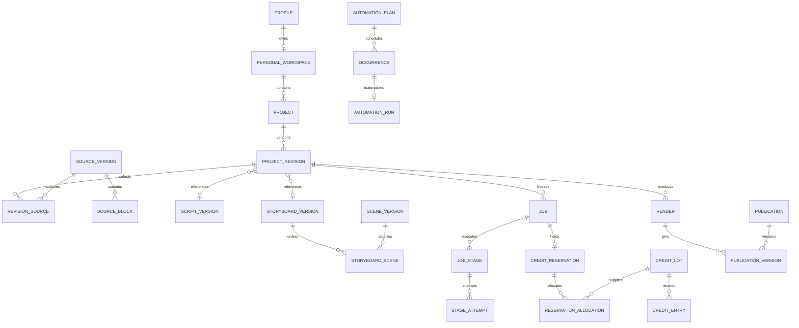

# V1 Database Design and Transaction Rules

Document version: 1.0  
Date: October 27, 2026 (Asia/Calcutta)  
Status: Proposed PostgreSQL design; no database, schema migration or access policy is applied by this document.  
Companions: [API design](api-design-v1.md), [dashboard architecture](dashboard-system-design-v1.md), [PRD](PRD.md).

## 1. Scope and implementation boundary

Cover persistence for all F01–F16 across V1 R1–R4, plus confirmed character/cinematic/presenter extensions. Preserve one private workspace per individual, both INR/USD price books, website-first delivery and shared future native entitlements. No team memberships, agency-client spaces or customer seat plans are introduced.

This is the proposed logical/physical table dictionary, integrity model, access strategy and transaction blueprint. JSON/SQL-style expressions are documentation, not executable migrations. Existing prototype contracts, local media, credentials and application code remain unchanged. Tables are introduced in dependency order by release; this is not an instruction to scaffold all later-release tables before R1.

The [API document](api-design-v1.md) owns client field names and wire formats. Relational columns use snake_case; API DTOs use camelCase. Database rows and encrypted/provider metadata are not returned directly as public DTOs. Final hosting/PostgreSQL version must be chosen from supported managed-service versions and pinned during implementation.

## 2. Conventions and integrity principles

### 2.1 Common field notation

Unless explicitly overridden, each application table has `id uuid` primary key generated server-side and `created_at timestamptz NOT NULL`. Customer-owned tables also have `workspace_id uuid NOT NULL` referencing `personal_workspaces(id)`. Mutable records have `updated_at timestamptz NOT NULL` and `row_version integer NOT NULL DEFAULT 1`, incremented atomically. Immutable versions/events do not have an editable row_version or generic content PATCH path.

In the dictionary, `?` means nullable; all other listed columns are NOT NULL unless a creation transaction temporarily supplies a deferred reference. `ref` denotes a real FK with matching UUID type and ownership scope, not an unvalidated string. `jsonb` bodies carry a required contract/version and are validated before persistence; JSON alone is not a business constraint.

Root exceptions: `profiles` is scoped directly to its verified `user_id` and does not require a workspace FK; `personal_workspaces.id` is the ownership root and does not contain another `workspace_id`. This permits idempotent profile → workspace provisioning without a mandatory circular insert. Explicitly global/restricted tables and nullable system-scope audit rows follow their stated scope instead of inheriting the customer workspace default.

| Type | Usage |
|---|---|
| `uuid` | Stable persisted resource and revision IDs |
| `timestamptz` | Execution/event instants stored and compared as UTC |
| `text` with bounded validation/check | Labels, state codes, IANA timezones, provider IDs, hashes and object keys |
| `integer` | Sequence/order numbers, row versions, milliseconds within bounded media ranges, fps and frames |
| `bigint` | Credit units, byte counts and customer money minor units; safe API integer-string transport |
| `numeric(24,12)` | Optional internal provider-cost metering in original currency where sub-cent precision is needed; not customer invoice Money DTO |
| `jsonb` | Versioned brief/scene/runtime/settings/policy payloads whose changing structure does not justify speculative columns |

Customer-facing currencies are constrained to INR/USD. Provider metering can retain a different original ISO currency and precision, with an explicit estimated/reconciled state. Never silently mix cost precision, customer charge amount and usage credits.

### 2.2 Ownership, uniqueness and immutable records

- Every customer-owned referenced object must be in the same workspace. Add `UNIQUE(workspace_id,id)` to referenced tables and use composite FKs. Project-specific references additionally enforce the same project, using `(workspace_id,project_id,id)` where needed.
- A UUID's global uniqueness does not establish authorization or same-workspace membership. Denormalized workspace/project columns are deliberate integrity boundaries, not trusted client input.
- Use text state codes with explicit checks or versioned reference tables; permit new states only through reviewed additive schema changes. Do not rely on client enums to protect stored state.
- Check same-row bounds with database constraints; enforce cross-row policy through FKs, locks, narrow transactional functions and audited application rules. Ordinary CHECK constraints are not a safe substitute for cross-table queries. [PostgreSQL constraints](https://www.postgresql.org/docs/current/ddl-constraints.html).
- Source/script/storyboard/scene/brand/runtime versions, approvals, ledger entries and immutable purchase/audit events are append-only during ordinary operation. Cleanup/anonymization is a restricted lifecycle operation, not an accidental cascade from a UI edit.
- Content hashes use a versioned canonical serializer including semantic configuration, ordered references and template/provider versions. Store the serializer/schema version; do not hash arbitrary JSON whitespace or assume every JSONB representation is a stable cross-runtime hash input.

### 2.3 Schema and privilege boundaries

Suggested separation: auth-provider schema for identities; application schema for customer resources; restricted internal tables/schema for credentials, raw verified callbacks and staff/audit operations; pg-boss-managed schema for queue infrastructure. Do not edit queue library tables manually or make them client-readable. Precise schema exposure is decided with the managed platform before migrations.

## 3. Relationship overview

The diagram shows core cardinalities, not every FK. Customer rows reference the personal workspace even when omitted for readability. New identity onboarding can briefly precede workspace provisioning; provision idempotently before allowing customer project operations. Deleted workspaces retain restricted financial/audit identity only under the approved retention policy.

## 4. Identity, preferences, consent and catalogs

| Table | Domain columns beyond common fields | Constraints / access |
|---|---|---|
| `profiles` | `user_id uuid UNIQUE` ref auth identity, `display_name text?`, `lifecycle text`, `onboarding_completed_at timestamptz?` | One profile per individual; no application password; user-scoped reads |
| `personal_workspaces` | `owner_user_id uuid?`, `lifecycle text`, `closed_at timestamptz?` | Active owner required; unique non-null owner; owner may be detached only by restricted completed-deletion/anonymization process |
| `preferences` | `user_id uuid UNIQUE`, `workspace_id ref`, `audience text?`, `use_case text?`, `timezone text`, `language text`, `billing_currency_preference text?`, `notification_settings jsonb` | Default English; IANA zone validated; INR/USD preference does not mutate a subscription |
| `consent_records` | `actor_user_id uuid?`, `purpose text`, `terms_version text`, `provider_disclosure_version text?`, `target_type text`, `target_id uuid?`, `recorded_at timestamptz` | Audited consent/rights context; content targets still require typed ownership validation; not a general permission grant |
| `catalog_versions` | Global table: `kind text`, `version text`, `contract_version text`, `status text`, `effective_at timestamptz` | Unique kind/version; service-managed, no customer mutation |
| `catalog_entries` | Global table: `catalog_version_id ref`, `entry_key text`, `label text`, `public_settings jsonb`, `provider_mapping jsonb`, `rights_reference text?`, `status text` | Unique catalog version/key; expose only allowlisted public DTO fields; mapping contains no API secret |
| `capability_flags` | Global or workspace-scoped by explicit scope: `scope text`, `workspace_id uuid?`, `capability_key text`, `enabled boolean`, `reason_code text?`, `rules_version text` | Scope/workspace consistency; at most one flag per scope/workspace/key; database NULL uniqueness handled explicitly |

Catalog kinds cover six baseline templates, fonts, music, English voices, character rigs/actions and presenters. The production style is one of `explainer_2d`, `cinematic`, `presenter`; a null character ID within explainer mode permits the original motion-only format. Model-supported duration/settings live in versioned capabilities, not unlimited arbitrary provider request JSON.

Global flags with null workspace need a separate partial unique index from workspace-specific flags, or an equivalent explicit global scope key. Do not assume a conventional nullable composite UNIQUE enforces one global flag.

## 5. Brand, assets and uploads

| Table | Domain columns | Constraints / behavior |
|---|---|---|
| `brand_kits` | `current_version_id uuid?`, `name text` | Proposed one default kit per personal workspace; pointer uses same-workspace brand version |
| `brand_versions` | `brand_kit_id ref`, `version_no integer`, `settings_schema text`, `settings jsonb`, `logo_asset_id uuid?`, `content_hash text` | Unique kit/version; immutable approved font/colors/tone/voice/CTA/settings snapshot |
| `upload_sessions` | `purpose text`, `project_id uuid?`, `state text`, `declared_bytes bigint`, `declared_mime text`, `expected_checksum text?`, `temporary_object_key text`, `expires_at timestamptz`, `completed_asset_id uuid?` | Positive bounded size; expiry; purpose-specific owner checks; transfer completion is not inspection success |
| `assets` | `kind text`, `state text`, `object_key text`, `sha256 text`, `mime_type text`, `byte_count bigint`, `width integer?`, `height integer?`, `duration_ms integer?`, `provenance jsonb`, `rights_reference text?`, `deleted_at timestamptz?` | Private object, valid metadata and positive applicable dimensions; unique storage key; content dedupe stays workspace-scoped |
| `artifact_references` | `asset_id ref`, exactly one typed `scene_artifact_id?`, `render_id?`, `brand_version_id?` or `scene_version_id?`, `purpose text` | CHECK exactly one target; same-workspace FKs; unique target/asset/purpose per typed target |

Narration, caption, thumbnail, source-image, generated-clip and final-video bytes all use `assets`; logical artifacts/manifests reference them. Object keys never substitute for an ownership check. A private asset need not have a permanent public URL column. Signed transfer URLs are generated on demand and not persisted as immutable media identities.

Original/provider rights, source/upload context, model version and allowed usage belong in provenance, not in customer-visible analytics. Raw provider responses containing secrets/private transient URLs are not stored blindly in provenance JSON.

## 6. Projects and immutable creative versions

### 6.1 Project/source families

| Table | Domain columns | Constraints / behavior |
|---|---|---|
| `projects` | `title text`, `current_revision_id uuid?`, `lifecycle text`, `archived_at timestamptz?`, `deletion_requested_at timestamptz?`, `last_accepted_render_id uuid?` | Head and accepted render belong to this project/workspace; create/head assignment in one transaction |
| `project_revisions` | `project_id ref`, `parent_revision_id uuid?`, `revision_no integer`, `brief_schema text`, `brief jsonb`, `target_duration_seconds integer`, `style text`, `brand_version_id uuid?`, `script_version_id uuid?`, `storyboard_version_id uuid?`, `settings jsonb`, `content_hash text`, `canonicalizer_version text`, `created_by_user_id uuid?` | Unique project/revision number; 30/60/90; supported style; immutable complete input snapshot and same-project references |
| `sources` | `kind text`, `title text?`, `origin_url text?`, `lifecycle text` | Workspace-owned source root; association to projects occurs through revisions |
| `source_versions` | `source_id ref`, `version_no integer`, `origin_url text?`, `retrieved_at timestamptz?`, `text_content text`, `content_hash text`, `extraction_metadata jsonb` | Immutable text/provenance; unique source/version |
| `source_blocks` | `source_version_id ref`, `block_key text`, `position integer`, `text_content text`, `content_hash text` | Unique source version/block key and source version/position; nonnegative contiguous application ordering |
| `source_confirmations` | `source_version_id ref`, `content_hash text`, `actor_user_id uuid`, `confirmed_at timestamptz` | Confirmation targets exact immutable text; edited extraction creates another version |
| `revision_sources` | `project_id ref`, `revision_id ref`, `source_version_id ref`, `position integer` | Unique revision/source and revision/position; same workspace; confirmed source membership checked at drafting/preflight |

Mutable project title/lifecycle and immutable creative brief title snapshots are distinct; changing content/settings advances the head. Duplicate/restored projects receive new identities/history and do not inherit job/payment/publication approvals. Assets may be shared within the same private workspace by explicit references.

### 6.2 Draft, script and storyboard families

| Table | Domain columns | Constraints / behavior |
|---|---|---|
| `ideas` | `project_id ref`, `origin_revision_id ref`, `content jsonb`, `state text`, `selected_in_revision_id uuid?`, `draft_result_id uuid?` | Source context retained; save/dismiss/select state mutable/audited; selection cannot discard sources |
| `draft_results` | `project_id ref`, `job_id ref`, `origin_revision_id ref`, `kind text`, `result_schema text`, `result jsonb`, `provider_attempt_id uuid?`, `state text` | Validated review output; immutable result body; a finished draft is not an approval |
| `script_versions` | `project_id ref`, `version_no integer`, `contract_version text`, `sections jsonb`, `estimated_duration_ms integer`, `content_hash text`, `draft_result_id uuid?` | Typed narration/display/pronunciation sections; immutable content; unique project/version |
| `storyboard_versions` | `project_id ref`, `version_no integer`, `script_version_id ref`, `contract_version text`, `content_hash text`, `estimated_duration_ms integer` | Immutable ordered-scene manifest via junction; unique project/version |
| `scenes` | `project_id ref`, `stable_key text` | Stable logical scene identity across edits; unique project/stable key |
| `scene_versions` | `project_id ref`, `scene_id ref`, `version_no integer`, `template_entry_id ref`, `schema_version text`, `narration text`, `pronunciation_text text?`, `display_text text`, `estimated_duration_ms integer`, `visual_settings jsonb`, `mode_settings jsonb`, `content_hash text` | Same-project scene; supported template and allowlisted character/presenter/shot settings; unique scene/version |
| `storyboard_scenes` | `project_id ref`, `storyboard_version_id ref`, `scene_version_id ref`, `position integer` | Unique storyboard/position and storyboard/logical scene; exactly one version of each logical scene in this storyboard |
| `content_source_refs` | `project_id ref`, exactly one `script_version_id?` or `scene_version_id?`, `source_block_id ref`, `reference_context jsonb` | Exactly one typed target; referenced block must belong to a source selected in the consuming revision; enforced during transactional validation |
| `content_review_flags` | `project_id ref`, typed script/storyboard/scene target, `code text`, `severity text`, `message text`, `state text`, `resolved_by_user_id uuid?`, `resolution_reason text?`, `resolved_at timestamptz?` | Exactly one target; open required flags block approval; resolution audited and never invents source evidence |

`storyboard_scenes` needs a logical-scene identity for a declarative uniqueness constraint: include `scene_id` and use a composite FK proving that `scene_version_id` belongs to that scene, then unique `(storyboard_version_id,scene_id)`. Do not attempt this uniqueness solely through a join in a CHECK expression.

Version creation validates template text limits, explicit statistic/chart data, allowed assets/actions and scene/duration bounds. Immutable catalog and source/version references retain reproducibility. New production contracts deliberately support all durations/styles; prototype schema `0.1.0` stays intact until separately migrated.

## 7. Approvals and render acceptance

| Table | Domain columns | Constraints / behavior |
|---|---|---|
| `approvals` | `project_id ref`, `scope text`, exactly one target `script_version_id?`, `storyboard_version_id?`, `render_id?`, `publication_version_id?`; `target_hash text`, `actor_basis text`, `actor_user_id uuid?`, `automation_run_id uuid?`, `automation_version_id uuid?`, `policy_evaluation_hash text?`, `approved_at timestamptz` | Target count exactly one and scope matches type; human actor OR explicit policy basis; policy basis allowed only for eligible exact-publication authorization |
| `approval_revocations` | `approval_id ref`, `reason text`, `actor_user_id uuid?`, `revoked_at timestamptz`, `event_key text` | Append-only; unique approval/event identity; revocation cannot silently replace historical content |
| `render_acceptances` | `project_id ref`, `render_id ref`, `runtime_hash text`, `actor_user_id uuid`, `accepted_at timestamptz`, `event_key text` | Exact validated render; idempotent acceptance event; not automatically publication approval |

Approval validity is a query/policy over exact target hash, dependencies, active review flags and revocations. It is not a mutable `projects.approved=true`. A manual decision cannot be created by model output. A policy-authorized publication records its actual run/policy evaluation and owner-configured permission, not a fabricated human click.

Foreign keys into later render/publication/automation tables are added when those releases introduce the target tables. Scope constraints remain complete at each migration stage. Do not weaken a production approval table with arbitrary unchecked `(type,id)` references to avoid migration ordering.

## 8. Jobs, requests, provider effects and media outputs

### 8.1 Durable operation and dispatch tables

| Table | Domain columns | Constraints / behavior |
|---|---|---|
| `api_requests` | `operation text`, `idempotency_key text`, `request_hash text`, `hash_version text`, `state text`, `result_kind text?`, `result_id uuid?`, `safe_response jsonb?`, `expires_at timestamptz` | Unique workspace/operation/key; repeated matching request returns same durable operation; safe response has no tokens/signed URLs |
| `estimates` | `project_id ref`, `revision_id ref`, `operation text`, `settings_hash text`, `capability_version text`, `credit_policy_version text`, `estimated_units bigint`, `maximum_units bigint`, `new_work jsonb`, `reused_work jsonb`, `expires_at timestamptz`, `state text` | Nonnegative, estimated ≤ maximum; frozen input identity; estimate is consumed by at most one intended operation |
| `jobs` | `project_id ref`, `revision_id ref`, `operation text`, `operation_key text`, `input_manifest jsonb`, `input_hash text`, `contract_version text`, `estimate_id uuid?`, `state text`, `current_stage text?`, `cancel_requested_at timestamptz?`, `finished_at timestamptz?`, `recovery_of_job_id uuid?`, `attempt_budget integer` | Unique workspace/operation key; no mutable frozen input; no client-controlled provider URL/code |
| `job_stages` | `job_id ref`, `stage_key text`, `input_hash text`, `state text`, `claim_epoch bigint`, `lease_owner text?`, `lease_expires_at timestamptz?`, `heartbeat_at timestamptz?`, `output_artifact_id uuid?` | Unique job/stage key; conditional claim updates and fencing token; compatible checkpoint reuse |
| `stage_attempts` | `job_stage_id ref`, `attempt_no integer`, `claim_epoch bigint`, `started_at timestamptz`, `ended_at timestamptz?`, `outcome text?`, `safe_error_code text?`, `provider_attempt_id uuid?` | Unique stage/attempt number; attempt recorded before external effect where applicable |
| `job_outbox` | `event_key text`, `event_type text`, `aggregate_id uuid`, `safe_payload jsonb`, `available_at timestamptz`, `dispatched_at timestamptz?`, `dispatch_attempts integer` | Unique event key; no secrets/raw customer content in queue payload; delivered at least once |

Free/nonbillable imports and maintenance jobs may lack an estimate/credit hold; billable draft/render operations require them. The operation type determines this invariant through transactional preflight. An HTTP replay cache expires independently from durable job/payment/provider deduplication records.

Add a partial unique index on non-null `jobs.estimate_id`: one accepted estimate authorizes one intended job. A reviewed recovery gets a new estimate and linked operation, including a zero-customer-unit estimate when covered by policy; it never reuses the old estimate or reverses the original settlement implicitly. The server verifies that the accepted unit ceiling equals the bound estimate, not a client-selected replacement.

### 8.2 External-effect and output tables

| Table | Domain columns | Constraints / behavior |
|---|---|---|
| `provider_attempts` | `job_stage_id ref`, `effect_key text`, `provider text`, `provider_account_ref text`, `model_version text`, `request_hash text`, `request_intent_at timestamptz`, `remote_request_id text?`, `remote_task_id text?`, `state text`, `outcome_certainty text`, `last_reconciled_at timestamptz?` | One logical effect journal per operation/input; repeated uncertain delivery cannot become a fresh paid call without reconciliation/explicit policy |
| `provider_usage` | `provider_attempt_id ref`, `meter_type text`, `quantity numeric(24,12)`, `unit text`, `cost_currency text?`, `cost_amount numeric(24,12)?`, `cost_state text`, `reconciled_at timestamptz?` | Nonnegative measured usage/cost; unknown remains null/unknown, not USD zero |
| `scene_artifacts` | `project_id ref`, `scene_version_id ref`, `kind text`, `cache_key text`, `provider_attempt_id uuid?`, `asset_id ref`, `input_hash text`, `metadata jsonb`, `validation_state text` | Unique workspace/kind/cache key for usable artifact; hash/provider/template/settings compatibility required |
| `artifact_dependencies` | `artifact_id ref` scene artifact, `dependency_artifact_id ref` scene artifact, `dependency_kind text` | Same-workspace/project FKs; unique directed edge/kind; no self-edge; application validates an acyclic supported-stage dependency graph |
| `runtime_manifests` | `project_id ref`, `revision_id ref`, `contract_version text`, `manifest jsonb`, `content_hash text`, `duration_frames integer`, `fps integer`, `measured_duration_ms integer` | Immutable audio/caption/visual references and measured schedule; positive frame/fps and consistent duration |
| `renders` | `project_id ref`, `revision_id ref`, `runtime_manifest_id ref`, `video_asset_id ref`, `thumbnail_asset_id uuid?`, `captions_asset_id uuid?`, `format text`, `state text`, `qa_report jsonb`, `render_input_hash text` | Ready only after stored bytes, checksum, full decode/audio/format/timing validation; immutable media identity |

Cache reuse is workspace-scoped by default. A hash includes narration/pronunciation, source/config references as relevant, voice/model/output format, template/renderer/schema version and any explicitly supported randomness seed. Credential rotation alone does not change the semantic content key. Do not globally reuse private source-derived artifacts across customers.

Caption artifacts explicitly depend on the exact audio artifact through `artifact_dependencies`; matching text alone does not establish matching timing. Runtime manifests validate those typed references and frame/caption bounds before render. Template/visual-only edits preserve unchanged audio and alignment, while narration/voice changes create new dependencies.

External systems and object storage do not share the relational transaction. Persist request intent before calling the provider, save remote IDs early, verify stored artifacts before completing a stage, and reconcile uncertain gaps. A database uniqueness constraint cannot force exactly-once behavior on an unsupported remote API.

## 9. Financial model: prices, purchases and credit lots

### 9.1 Price and entitlement tables

| Table | Domain columns | Constraints / behavior |
|---|---|---|
| `price_books` | Global: `version text`, `status text`, `effective_at timestamptz`, `policy_version text` | Immutable published version; draft definitions not selectable at checkout |
| `prices` | Global: `price_book_id ref`, `product_key text`, `kind text`, `currency text`, `amount_minor bigint`, `interval text?`, `included_units bigint`, `provider text`, `provider_price_id text`, `tax_display_mode text` | INR/USD; amount/units ≥0; unique published product/kind/currency/interval within book |
| `subscriptions` | `provider text`, `environment text`, `provider_account_ref text`, `provider_subscription_id text`, `price_id ref`, `billing_currency text`, `state text`, `period_start timestamptz`, `period_end timestamptz`, `cancel_at_period_end boolean`, `provider_state_version text?` | Unique provider/account/environment/subscription; at most one active/grace subscription per workspace through an explicit constrained transition |
| `purchase_receipts` | `provider text`, `environment text`, `external_transaction_id text`, `purchase_origin text`, `price_id uuid?`, `currency text`, `amount_minor bigint`, `state text`, `verified_at timestamptz?`, `superseded_by_id uuid?` | Unique provider/environment/account/transaction identity; server verification before grants |
| `payment_events` | `webhook_inbox_id ref`, `event_key text`, `subscription_id uuid?`, `purchase_receipt_id uuid?`, `effect_kind text`, `applied_at timestamptz?` | Unique normalized effect; provider replay cannot duplicate grants/renewals |
| `invoices` | `provider text`, `environment text`, `external_invoice_id text`, `subscription_id uuid?`, `purchase_receipt_id uuid?`, `currency text`, `subtotal_minor bigint`, `tax_minor bigint`, `total_minor bigint`, `state text`, `issued_at timestamptz?`, `document_reference text?` | Currency/issued amounts immutable after finalization; corrections use provider credit/refund records, not rewriting history |
| `billing_transitions` | `subscription_id ref`, `kind text`, `from_price_id uuid?`, `to_price_id uuid?`, `quoted_terms jsonb`, `quote_expires_at timestamptz`, `state text`, `event_key text` | Explicit quote/confirm for currency/plan changes; same-currency refund/provider reconciliation rules |

Add `provider_account_ref` to every provider-unique receipt/invoice key so identical external IDs from another merchant/environment cannot collide. Store only safe provider/customer references; sensitive billing documents/payment details remain in approved restricted/provider storage with authorized access.

### 9.2 Credit accounts and immutable entries

| Table | Domain columns | Constraints / behavior |
|---|---|---|
| `credit_accounts` | `workspace_id UNIQUE`, `available_units bigint`, `reserved_units bigint`, `consumed_units bigint`, `financial_hold boolean`, `last_reconciled_at timestamptz?` | Nonnegative projections; lock this row before competing workspace spending/grants; all changes paired with immutable entries |
| `credit_lots` | `origin_kind text`, `origin_receipt_id uuid?`, `origin_payment_event_id uuid?`, `allowance_period_key text?`, `grant_units bigint`, `available_units bigint`, `reserved_units bigint`, `consumed_units bigint`, `expired_units bigint`, `revoked_units bigint`, `expires_at timestamptz?`, `policy_version text` | Each counter ≥0; available + reserved + consumed + expired + revoked = granted; unique verified grant origin/period |
| `credit_reservations` | `job_id UNIQUE ref`, `estimate_id ref`, `maximum_units bigint`, `state text`, `settled_units bigint?`, `released_units bigint`, `expires_at timestamptz?`, `settlement_key text?` | One hold per intended job; final settlement ≤ accepted maximum; unique non-null settlement key; terminal state transition once |
| `reservation_allocations` | `reservation_id ref`, `credit_lot_id ref`, `allocated_units bigint`, `consumed_units bigint`, `released_units bigint` | Unique reservation/lot; nonnegative; consumed + released ≤ allocation; remaining amount is held |
| `credit_entries` | `credit_lot_id ref`, `reservation_id uuid?`, `event_key text`, `kind text`, signed bigint `grant_delta`, `available_delta`, `reserved_delta`, `consumed_delta`, `expired_delta`, `revoked_delta`; `policy_version text`, `job_id uuid?`, `reversal_of_entry_id uuid?` | Append-only; unique workspace/event/lot; sum of five state deltas = grant delta; legitimate signed reversals permitted |

`credit_entries` is the auditable source; account/lot counters are transactionally updated projections and reconciled against it. Entries do not contain currency amounts. API `/usage` presents their meaningful event group and integer-string quantities, not an unexplained raw accounting tuple.

Illustrative ledger movement for a 100-unit lot and a 40-unit hold:

| Event | Grant delta | Available | Reserved | Consumed | Expired | Revoked |
|---|---|---|---|---|---|---|
| Verified grant | +100 | +100 | 0 | 0 | 0 | 0 |
| Reserve maximum 40 | 0 | −40 | +40 | 0 | 0 | 0 |
| Settle 35, release 5 | 0 | +5 | −40 | +35 | 0 | 0 |
| Later expire 20 unused | 0 | −20 | 0 | 0 | +20 | 0 |

This is an accounting example, not pricing. A grant of 100 does not mean ₹100 or $100. Subscription allowance/purchased-pack expiry, reservation expiry handling, lot ordering and covered-failure refunds are explicit policy versions before R2. A purchase refund may revoke unused units; spent-unit disputes require an explicit account hold/reconciliation policy rather than silently taking available balance negative or pretending consumption never happened.

Currency changes do not convert prior invoices/lots through live FX. Native/store receipts retain origin and original transaction currency while feeding the same credit account. Revocation/restores/duplicate submissions share receipt identity and cannot grant another lot accidentally.

## 10. OAuth, social destinations and publications

| Table | Domain columns | Constraints / behavior |
|---|---|---|
| `credential_references` | Restricted: `kind text`, `provider text`, `encrypted_payload_reference text`, `key_version text`, `expires_at timestamptz?`, `revoked_at timestamptz?` | Reference to encrypted token store; never client-readable; app provider secrets preferably remain in deployment secret manager |
| `oauth_sessions` | `platform text`, `actor_user_id uuid`, `state_hash text`, `intent text`, `return_path text`, `expires_at timestamptz`, `consumed_at timestamptz?`, `pkce_reference text?` | Unique one-time state; short-lived binding; no tokens in return URL; PKCE where supported |
| `social_connections` | `platform text`, `external_account_id text`, `display_identity jsonb`, `capabilities jsonb`, `capability_checked_at timestamptz?`, `credential_reference_id ref`, `health text`, `disconnected_at timestamptz?` | Unique active workspace/platform/destination; reauthorization updates credential reference without silently changing destination identity |
| `publications` | `project_id ref`, `current_version_id uuid?`, `state text`, `scheduled_at timestamptz?`, `claim_epoch bigint`, `lease_expires_at timestamptz?`, `cancel_requested_at timestamptz?`, `remote_post_id text?`, `remote_state text?` | Mutable execution aggregate; version/state conditional updates; unique remote identity where known under provider/account scope |
| `publication_versions` | `publication_id ref`, `project_id ref`, `version_no integer`, `render_id ref`, `connection_id ref`, `metadata_schema text`, `metadata jsonb`, `scheduled_at timestamptz?`, `timezone text`, `local_datetime text?`, `utc_offset_minutes integer?`, `content_hash text` | Immutable fixed media/destination/metadata/time intent; unique publication/version; same-owner render and connection |
| `publication_attempts` | `publication_id ref`, `publication_version_id ref`, `attempt_no integer`, `effect_key text`, `remote_upload_id text?`, `remote_container_id text?`, `remote_post_id text?`, `state text`, `outcome_certainty text`, `safe_error_code text?`, `last_reconciled_at timestamptz?` | Preserve remote IDs before retry; no blind second upload after uncertainty; unique logical effect identity |

One render to YouTube and Instagram creates two publications. Local upload success and public visibility are separate states. Timezone validation proves that UTC instant, local representation and offset agree; handle daylight-saving ambiguity explicitly. An account timezone change does not rewrite publication versions. A project edit does not replace a pinned render.

Connection disconnection blocks new local dispatch and reconciles already scheduled remote work; it is not remote-post deletion. Eligibility/scopes/processing constraints are provider implementation gates; no guessed Instagram account coverage is encoded as universal support.

## 11. Automation, occurrence uniqueness and budgets

| Table | Domain columns | Constraints / behavior |
|---|---|---|
| `automation_plans` | `name text`, `current_version_id uuid?`, `state text`, `control_epoch bigint`, `next_due_at timestamptz?`, `paused_at timestamptz?` | Stable plan identity; conditional epoch updates; owner vs policy pause reasons |
| `automation_versions` | `plan_id ref`, `version_no integer`, `policy_schema text`, `policy jsonb`, `timezone text`, `cadence jsonb`, `per_run_maximum_units bigint`, `period_maximum_units bigint`, `content_hash text`, `auto_publish_enabled boolean`, `opt_in_consent_id uuid?` | Immutable policy; finite positive bounds; unique plan/version; auto-publish requires explicit consent and constraints |
| `automation_source_refs` | `automation_version_id ref`, `source_version_id ref` | Unique version/source; only approved confirmed owner sources |
| `occurrences` | `plan_id ref`, `automation_version_id ref`, `occurrence_key text`, `scheduled_at timestamptz`, `control_epoch bigint`, `state text` | Unique plan/cadence-slot key; timezone/DST interpretation persisted |
| `automation_runs` | `occurrence_id UNIQUE ref`, `project_id uuid?`, `state text`, `control_epoch bigint`, `policy_evaluation jsonb?`, `policy_evaluation_hash text?`, `finished_at timestamptz?` | One materialized run per occurrence; exact policy and current control epoch checked before effects |
| `automation_budget_accounts` | `plan_id ref`, `period_start timestamptz`, `period_end timestamptz`, `timezone text`, `maximum_units bigint`, `reserved_units bigint`, `consumed_units bigint` | Unique plan/period; reserved + consumed ≤ maximum; periods reflect plan timezone |
| `budget_reservations` | `budget_account_id ref`, `run_id ref`, `job_id ref`, `maximum_units bigint`, `consumed_units bigint`, `released_units bigint`, `state text`, `event_key text` | Unique run/job/budget hold; coordinate with workspace credit reservation in same transaction |

Policy JSON references exact brand/catalog/style/destination constraints, content pillars, horizons, review rules and limits; referenced entity ownership is validated rather than inferred from JSON IDs. Introduce typed junctions for other reusable references when those references need independent FK enforcement. Source FKs are explicit because source boundaries are critical to grounded content.

Pause advances `control_epoch`; new occurrences and stage/publish dispatch compare it. A stale queued run cannot spend simply because its old policy was active at creation. Already in-flight remote calls remain uncertain until reconciled. Resume defaults to prospective slots without unbounded catchup; edits do not duplicate or rewrite prior confirmed publications.

## 12. Notifications, callbacks, support and lifecycle

| Table | Domain columns | Constraints / behavior |
|---|---|---|
| `notifications` | `user_id uuid`, `event_key text`, `category text`, `safe_payload jsonb`, `read_at timestamptz?` | Unique owner/event/category; resource deep link retrieval still authorized |
| `notification_deliveries` | `notification_id ref`, `channel text`, `state text`, `attempt_no integer`, `sent_at timestamptz?`, `safe_error_code text?` | Unique notification/channel/attempt; delivery outcome separate from business operation |
| `webhook_inbox` | Restricted/global: `provider text`, `environment text`, `provider_account_ref text`, `event_id text`, `payload_hash text`, `verified_at timestamptz`, `received_at timestamptz`, `state text`, `processing_attempts integer`, `safe_event jsonb`, `encrypted_raw_reference text?` | Unique provider/environment/account/event; persist only verified events for normal processing; invalid attempts logged separately without secrets |
| `audit_events` | Workspace nullable only for system scope: `actor_basis text`, `actor_reference text`, `action text`, `target_type text`, `target_id uuid?`, `before_hash text?`, `after_hash text?`, `reason text?`, `request_id text` | Append-only; no raw content/credentials; staff reason required for sensitive intervention |
| `staff_authorizations` | Restricted/global: `staff_user_id uuid`, `role text`, `state text`, `granted_at timestamptz`, `expires_at timestamptz?` | Separate internal identity/permissions; no customer-workspace membership grant |
| `support_requests` | `user_id uuid`, `category text`, `message text`, `safe_context jsonb`, `state text` | Customer message is private support content, not ordinary analytics; optional attachments use explicit assets |
| `deletion_requests` | `scope text`, `project_id uuid?`, `requested_by_user_id uuid?`, `state text`, `impact_hash text`, `requested_at timestamptz`, `completed_at timestamptz?`, `hold_reason text?` | Account/project scope matches target; idempotent request identity; no duplicate destructive dispatch |
| `object_tombstones` | `asset_id uuid?`, `object_key text`, `reason text`, `delete_after timestamptz`, `state text`, `deleted_at timestamptz?` | Recheck active references/jobs before deletion; metadata retained only under policy |

Dashboard summaries are owner-scoped queries/projections, not another authoritative lifecycle database. Start with indexed queries/views. If denormalized `dashboard_projections` are introduced, store workspace/projection key, projection version, last event/updated time and summary JSON; rebuild from canonical records. A stale or failed projection is explicitly unavailable, not proof of a zero balance or zero publications.

## 13. Financial and execution transaction boundaries

PostgreSQL constraints/isolation/locks are mechanisms; the transactions below are our proposed application rules. Use narrow transactional functions or backend commands with explicit lock order. Do not hold database transactions open while calling providers. [PostgreSQL transaction isolation](https://www.postgresql.org/docs/current/transaction-iso.html).

### T01 — Provision individual workspace

Insert-or-read the profile by verified auth subject, insert-or-read the unique active workspace owner, initialize preferences/credit account, then commit. A repeated auth callback cannot create another workspace or another free allowance grant. Any initial allowance is a separate idempotent policy event, not a side effect of every login.

### T02 — Save content revision

Check owner/project lifecycle; lock project head; compare `expectedRevisionId`; validate referenced source/brand/content ownership and supported schema; append changed immutable versions/junctions; append project revision and audit/invalidation facts; atomically advance head; commit. A failed transaction leaves no partial head or orphaned approved version exposed. Do not rerun an externally billed draft inside a serialization retry.

### T03 — Approve exact target

Lock/check current project head and target identity; check source membership/confirmation and required review flags; record target hash, actor basis and scope; append approval/audit; commit. Publication approval similarly binds its current version, fixed render, destination and metadata. A concurrently changed target fails instead of granting stale approval.

### T04 — Reserve and dispatch billable work

1. Resolve matching idempotency row or claim its unique key. Validate exact estimate and its unexpired input/price/capability/policy identity.
2. Lock workspace credit account; if automated, also lock the plan and period budget in the documented order below.
3. Lock eligible credit lots in a deterministic expiry/ID order under the approved lot policy. Confirm available units, workspace limits and lifecycle.
4. Create job, hold and lot allocations; append reserve entries and update lot/account projections. For automated work, create the matching budget reservation/counters.
5. Insert unique outbox dispatch and record the idempotent result/job ID. Mark estimate consumed by this intended operation.
6. Commit, then return `202`. Dispatcher sends outside the transaction; repeated delivery refers to the same job.

No request-visible success occurs before durable commit. Concurrent jobs cannot observe the same available units and both spend them. Expired estimates, insufficient funds/limits or state conflicts roll back without calling a provider.

### T05 — Claim stage and reconcile provider effect

Conditionally claim eligible stage, increment `claim_epoch`, create attempt, set lease/heartbeat and commit. Before external paid work, persist a unique effect journal and input hash. Where supported, use the same provider idempotency identity/task lookup. After response, persist remote IDs and verified artifact checkpoint with current fence. A worker that lost the fence cannot finalize newer state. An existing uncertain effect is reconciled or escalated, not replaced by a blind paid request.

Use short polling/claim transactions with appropriate row locks; `SKIP LOCKED` may help queue-style claiming where supported. This is not an assertion that one SQL option guarantees exactly-once external delivery. Network calls remain outside locks/transactions.

### T06 — Settle terminal work

Acquire locks in the same account/plan/budget/lot/reservation order used by dispatch. Detect an existing unique settlement result. Determine consumed/released units under the accepted ceiling and policy, append per-lot entries, update all projections/allocations, finalize hold/budget/job/output state and append notification outbox; commit once. Unspent units are released exactly once. A covered internal retry cannot create another customer charge.

A stage requiring human timing/content review is not a successful render. Record completed cost/retained artifacts and release unused funds according to policy. Newly authorized content/regeneration creates a linked job with a new estimate; it does not mutate the old frozen job or erase its invoice/usage uncertainty.

### T07 — Apply verified purchase/renewal/refund

Persist/dedupe verified inbox event, reconcile provider state outside any long transaction, then transact the normalized financial effect. Lock credit account and related subscription/receipt; reject previously applied effect identity; create/update verified receipt and subscription transition; grant/revoke/reverse applicable lots with immutable entries; update projections; append safe notification/audit; mark event applied. Duplicate or out-of-order provider events cannot duplicate credit grants. Checkout navigation alone never invokes this transaction.

### T08 — Publish schedule and remote reconciliation

Lock publication/current version, check exact active approval, connection/capability and due-time interpretation, create unique outbox effect and commit. Worker claims/fences, persists remote session/container IDs, uploads/observes remote processing and records outcomes. On uncertainty, reconcile before any new remote effect. Reschedule/cancel uses conditional version/state transitions and actual provider reversibility; local `cancel_requested` does not assert remote cancellation.

### T09 — Materialize automation occurrence

Lock credit account when spending will occur, then plan/control epoch and budget period, then eligible lots, existing occurrence/run/job and holds in deterministic ID order. Claim unique occurrence, bind immutable policy/current epoch, reserve bounded workspace+plan units and create run/job/outbox atomically. A pause takes the plan lock, increments epoch and prevents later stale dispatch. Treat in-flight effects separately; no lock can retract an already accepted external request.

### Shared lock order and retries

Document and enforce a shared order: workspace credit account → automation plan/control (when applicable) → budget period → eligible lots ordered by expiry/ID → operation/job/reservation records in deterministic ID order. Content-only saves need only their project locks; do not acquire financial locks later in reverse order. Where a command needs both project validation and finances, validate a frozen revision first and recheck lifecycle/approval atomically without holding an inverse lock path.

Investigate deadlocks/serialization failures and retry only the database transaction with bounded backoff and the original operation identity. Never place a network/provider side effect inside a transaction closure that the database client may execute again. Test actual isolation/lock behavior with concurrent transactions; do not assume a read-then-insert check is atomic.

## 14. RLS, privileges and secret boundaries

Customer identity is verified at the application boundary and enforced with appropriate database/storage policies. Owner-scoped policies join to `personal_workspaces.owner_user_id = auth.uid()` (or equivalent verified auth subject) and require active lifecycle. User-controlled metadata claims do not select a workspace. [Supabase RLS](https://supabase.com/docs/guides/database/postgres/row-level-security).

| Data category | Customer access | Service/operator access |
|---|---|---|
| Profile/preferences and owned project/content summaries | Authorized owner reads; writes through validated application commands | Restricted application services |
| Immutable creative versions/approved media | Owned reads; no direct mutation of immutable history | Append through approved version/cleanup paths |
| Jobs/stages/provider attempts | Safe owner DTOs only; do not expose unrestricted internal tables | Worker-specific claims/finalization and reconciliation |
| Credit/price/subscription/invoice data | Safe owned billing views; no direct balance/receipt editing | Narrow financial transactions; staff audited recovery |
| OAuth credentials/raw callbacks/staff authorization | No client grants or dashboard raw-row access | Restricted secrets/inbox/staff service identity |
| Global catalogs/capabilities | Public-safe curated projection; no provider-secret mapping | Versioned service administration |
| Customer-content support/audit | Owned support view where appropriate; audit DTOs sanitized | Least privilege, recorded reason and approved retention |

Use RLS as defense in depth, not as a replacement for composite-FK ownership and business checks. Privileged/service credentials bypass ordinary owner policies; workers still validate job/workspace relationships explicitly. Do not expose all tables through automatic APIs by default.

Narrow database functions used for atomic holds/settlement must authenticate the actor, fix object resolution/search paths, enforce permissions and accept only validated operation inputs. A generic security-definer RPC that accepts arbitrary SQL, an arbitrary workspace ID or an arbitrary balance delta is not part of this design. Prefer revoking direct client mutation privileges on financial/immutable/execution tables.

## 15. Indexes, dashboard reads and lifecycle performance

| Query | Proposed index / plan |
|---|---|
| Private active projects ordered by last edit | `(workspace_id,lifecycle,updated_at DESC,id DESC)`; partial active index if measured useful |
| Workspace title search | Indexed normalized title or bounded full-text strategy after query-plan measurement; no cross-owner source scan |
| Revisions / scene history | `(workspace_id,project_id,revision_no DESC)` and `(workspace_id,scene_id,version_no DESC)` unique/history indexes |
| Active jobs / stale leases | `(workspace_id,state,updated_at)` plus service-only eligible-stage/due/lease indexes |
| Artifact reuse | Unique `(workspace_id,kind,cache_key)` and typed dependency-reference indexes |
| Credit summary/history | Unique account/workspace; `(workspace_id,created_at DESC,id DESC)` entries; eligible lots by expiry/ID |
| Financial callbacks | Unique provider/environment/account/event/transaction keys; pending inbox by received time |
| Due publications | Partial `(scheduled_at,id)` for eligible scheduled state; destination/history index by workspace/connection |
| Automation due slots | Unique plan/occurrence key, due plan/occurrence indexes, unique plan/budget-period |
| Notification list | `(workspace_id,user_id,read_at,created_at DESC,id DESC)` or partial unread index after measurement |
| Cleanup | Tombstones by state/delete_after; active asset reference indexes to prevent unsafe deletion |

Indexes must include exact predicate/sort semantics when migrated; nullable expiry sorting and active-state partial uniqueness need explicit tests. Do not index every JSON field or split database services before measured query/maintenance pressure justifies it. Use cursor pagination with stable ID tie-breakers and bounded dashboard aggregates.

Application outbox/inbox/stage journals and audit/usage history grow independently from media objects. Set cleanup/archive retention after recovery/financial requirements, not arbitrary daily truncation. Partitioning is a later measured optimization, not an initial schema prerequisite.

## 16. Deletion, backups and migrations

Customer deletion is a lifecycle transaction plus reconciled cleanup: tombstone project/account; block new work; stop/reconcile automation/publication/provider actions; release eligible holds; remove source/derived assets only when no retained reference or active operation needs them; anonymize/delete identity/content under policy; preserve restricted mandatory financial records and audit truth.

Avoid broad cascade paths from project deletion into ledger, purchase receipts, provider-effect journals or published remote IDs. Content children can have controlled cascading cleanup within a deletion task after reference checks. Financial/audit FKs normally restrict deletion or point to a retained pseudonymous financial subject. Before auth identity deletion, detach/anonymize retained workspace financial ownership and actor references through the approved procedure; do not leave dangling auth FKs or preserve unnecessary personal content indefinitely.

Carry forward proposed PRD defaults: temporary previews/failed intermediates expire after seven days when unused; active-system deletion target within 30 days; sources/final exports otherwise retained until customer deletion or explicit account policy. Backup, billing/audit and provider-retention periods remain final decisions before R2. Restores must replay deletion tombstones and reconcile external effects before reopening processing.

Migration phases:

1. Identity/workspace/preferences and basic credit-account identity, catalogs/assets and immutable creative versions; owner policies and safe local imports.
2. Approval graph, estimates/jobs/outbox/provider effects/runtime artifacts, test-unit lots/entries/holds, selective reuse and status/recovery for R1. Initial pilot grants are finite configured policy events, not real purchases.
3. Real price books/purchases/subscriptions, full financial/ledger hardening and staff/notification/deletion operations for R2.
4. OAuth/connection/publication records and provider-specific indexes for R3.
5. Plan/occurrence/budget/policy authorization tables for R4.
6. Additional-style catalog/schema fields and native receipt adapters through compatible additive releases when their gates pass.

Use expand/backfill/validate/contract migrations and verify existing data before enabling constraints. Record migration/version checksums and rollback/restore procedures. Long-held locks, initial cyclic head pointers and later typed approval-target FKs need an explicit migration plan. A file named “design” is not authorization to run DDL against development or production.

## 17. Database acceptance scenarios

| ID | Scenario | Required assertion |
|---|---|---|
| DB01 | Repeated signup/provision | One active personal workspace/account and one allowance grant per verified policy event |
| DB02 | Cross-workspace source/asset/brand/job/approval reference | Composite FK/application policy rejects; no private data leakage |
| DB03 | Two-device revision save/restore | One expected-head mutation wins; immutable history and local conflict evidence preserved |
| DB04 | Scene reorder/duplicate/version reuse | Unique positions and one logical scene version per storyboard; no orphaned current head |
| DB05 | Unsupported JSON/template/mode/schema | Typed validation rejects before production instructions persist |
| DB06 | Stale approval/flag/source hash | Dispatch cannot reuse a decision for a different target/dependency |
| DB07 | Duplicate request/outbox/stage delivery | Same durable operation, hold and verified effect; no duplicate charge |
| DB08 | Concurrent jobs and plan budgets | Accepted spend stays within locked workspace/lot/plan maximums |
| DB09 | Crash around provider call/artifact commit | Known request/outcome retained; no blind paid repetition; old fence cannot finalize |
| DB10 | Settlement/cancel/refund replay | One terminal result, correct lot deltas and released balances; no negative projection |
| DB11 | Purchase event replay/order/store restore | One verified entitlement/grant per provider transaction/period; origin/currency retained |
| DB12 | Allowance expiry while reserved | Defined lot policy, correct held/available/expired counters and no lost units |
| DB13 | INR/USD plan change/invoice correction | Original money/currency immutable; explicit price transition; no implicit FX |
| DB14 | OAuth revoke or wrong callback state | One-time binding enforced; disconnected destination cannot dispatch |
| DB15 | Uncertain remote publication/two destinations | Remote identity/reconciliation retained; separate outcomes, no blind duplicate |
| DB16 | Recurrence duplicate/pause/DST/month boundary | One occurrence, correct period/control epoch and no invalid time interpretation |
| DB17 | Direct client write to protected table | Database privileges/RLS deny financial, credential and immutable-history mutation |
| DB18 | Asset cleanup/account deletion/restore | No needed object removed, private content resurrected or side effect repeated |
| DB19 | Dashboard query load and projection lag | Bounded owner query plans; unavailable/stale is not a false zero |
| DB20 | Reconcile ledger projections | Counters equal immutable sums and lot/account invariants; discrepancies alert/block unsafe spend |

These are required future tests, not executed results. Do not label distributed recovery, billing or isolation passed because the current local narrated prototype succeeded.

## 18. Requirement/API traceability

| Requirement | Main table groups | API IDs |
|---|---|---|
| F01 | Identity/preferences, deletion and access policies | A01–A02, A06 |
| F02 | Brand versions, assets and project snapshots | A17–A19 |
| F03 | Sources/versions/blocks/confirmations, upload sessions | A09, A21–A26 |
| F04 | Ideas, draft results, job/estimate context | A27, A32 |
| F05 | Script versions, source references, flags, approvals | A27, A30–A31 |
| F06 | Storyboards/scenes/junctions and exact revision heads | A28–A31 |
| F07 | Catalogs, jobs, scene artifacts and renders | A04–A05, A32–A34 |
| F08 | Voice catalog, audio assets/manifests, provider attempts | A05, A28, A32–A34 |
| F09 | Caption assets and audio-version/runtime dependencies | A28, A37, A39 |
| F10 | Immutable versions, references, dependency cache and restore | A11, A15–A16, A28–A29 |
| F11 | Renders, QA, acceptance and authorized object references | A37–A39 |
| F12 | Project/job read models, lifecycle and safe recovery | A03, A08, A10–A16, A20, A34–A36 |
| F13 | Price/subscription/receipt/invoice, credit account/lot/entry and holds | A32–A33, A40–A47, A70 |
| F14 | OAuth sessions, connection and credential references | A48–A51 |
| F15 | Publication versions/attempts and exact approval | A52–A59 |
| F16 | Plan versions, occurrences/runs, budgets and notification/audit | A60–A67 |
| C01–C03 | Mode-specific catalog/settings, provider artifacts/runtime manifests | A04–A05, A28–A34 |

## 19. Remaining decisions and references

Before implementation: choose managed database/storage versions and migration tooling; define final input/storage/concurrency bounds; finalize price/refund/lot expiry/order and account-hold rules; choose payment/entity/tax behavior; confirm style/provider and social-account capabilities; set actual backup/audit retention, native receipt/deprecation support and operator permission roles. No unresolved business rule is silently replaced by a developer convenience default.

References checked October 27, 2026:

- [PostgreSQL constraints](https://www.postgresql.org/docs/current/ddl-constraints.html): FK/unique/check mechanisms; actual proposed table rules are our design.
- [PostgreSQL transaction isolation](https://www.postgresql.org/docs/current/transaction-iso.html): concurrency semantics; external effects still require application journals/reconciliation.
- [Supabase RLS](https://supabase.com/docs/guides/database/postgres/row-level-security): owner-policy mechanism and privilege considerations.
- [API contracts](api-design-v1.md), [dashboard architecture](dashboard-system-design-v1.md), [V1 PRD](PRD.md) and [V1/V2 roadmap](product-roadmap.md).

This task creates documentation only. It neither applies these tables/policies nor edits application code, migrations, credentials or database contents. Any later code/database changes require the user's permission.
