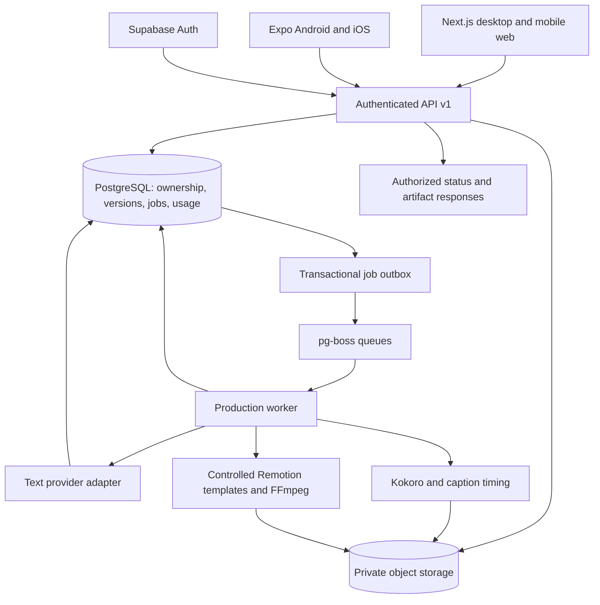
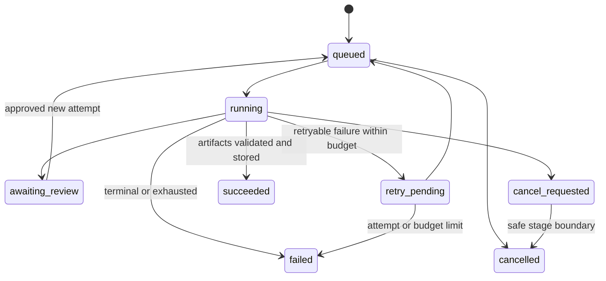

# V1 pipeline technical design

Date: October 27, 2026.  
Status: Design for implementation, not an implemented service.  
Scope: individual-user V1; desktop/mobile web and planned Android/iOS clients.

## 1. Architecture decisions

Build one backend-owned production pipeline with two client interfaces. The web client can offer an interactive preview; mobile clients initially use a backend-produced preview. All clients operate on the same projects, versions and jobs.



Keep API application services separate from route handlers. Next.js may host the first API endpoints; a later independent API deployment must not change contracts. Rendering and inference never execute inside a browser request or depend on the phone staying awake.

### Initial decisions and tradeoffs

| Decision | Reason | Revisit when |
|---|---|---|
| TypeScript monorepo, shared contracts/client/domain rules | Reuse product behavior across web/native | Platform dependencies require a clean package boundary |
| Separate web and native views | The editor uses web/Remotion components; phones need touch layouts | A universal component proves suitable in the prototype |
| Structured scene schema + template allowlist | Inspectable and bounded rendering | Add another template through a versioned renderer release |
| Narration per scene | Reuse untouched audio after edits | Scene boundaries cause audible joins; improve pauses/normalization |
| PostgreSQL outbox + pg-boss | Durable dispatch without requiring Redis | Throughput/connection measurements justify another queue |
| Lightweight rendered mobile previews | Native clients do not execute the web composition | Preview latency becomes a measured usability problem |
| Local/private storage adapter for first rendering spike | Avoid infrastructure work before proving output | Shared web/native test needs deployed signed access |

Do not promise complete source-code or UI reuse. Rendering templates are web/worker code, not native React views.

## 2. Component responsibilities

| Component | Owns | Must not do |
|---|---|---|
| Web/native client | Input, editing, previews, approvals, progress, permitted save/share | Hold provider/admin secrets; decide authoritative balance or access |
| API application layer | Identity verification, ownership, validation, revisions, estimates, reservations and job submission | Run long media jobs synchronously |
| Database | Immutable versions, consistent ownership, durable states, ledger/outbox uniqueness | Treat a mutable project head as an approved artifact |
| Dispatcher | Deliver pending outbox entries to pg-boss, then mark dispatch | Assume a crash cannot occur between queue send and marking |
| Worker | Stage execution, content cache, provider reconciliation, timings, artifact validation | Trust queue payloads as authorization or render arbitrary URLs/code |
| Text adapter | Versioned prompts, schema-constrained output, usage metadata | Decide factual correctness or customer approval |
| Inference process | Narration and timestamp candidates | Expose a public unauthenticated inference endpoint |
| Storage adapter | Private objects and short-lived authorized transfer URLs | Make project media permanently public by default |

Worker payloads contain IDs, not secrets or complete customer text. Fetch the frozen job manifest from the database under a restricted service identity.

## 3. Stage-by-stage pipeline

| Stage | Input | Output | Validation/gate |
|---|---|---|---|
| 1. Source capture | Pasted text or validated upload; URL importer later | Source version and block IDs | Ownership, length limits, provenance and user-confirmed extracted text |
| 2. Brief/ideas | Source blocks, audience, goal, duration | Chosen idea/brief revision | User selects/edits; no fabricated trend claims |
| 3. Script drafting | Frozen selected sources and brief | Script version with references/review flags | Schema + claim-reference integrity; individual approval |
| 4. Storyboard drafting | Approved script, brand snapshot, allowed templates | Ordered scene data and estimated timing | Validate content/limits; preview; individual approval |
| 5. Production preflight | Approved revision and accepted estimate | Frozen production manifest | Recheck entitlement, source/asset ownership, referenced versions and spend cap |
| 6. Narration | Scene narration, pronunciation overrides, voice/provider version | Scene WAV and measured metadata | Decode succeeds, speech is present, timing plausible |
| 7. Captions/timing | WAV + approved display/narration text | Reviewed caption cues and frame schedule | Alignment confidence, word matching, no invalid timestamps |
| 8. Composition | Fixed templates, brand, scene assets, measured timings | Preview/final render | Text fits, allowed assets/fonts, deterministic props |
| 9. Technical QA | Encoded output | Validation report + thumbnail + MP4 + SRT | Codecs, dimensions, runtime, decode, sync, no missing narration |
| 10. Completion | Validated stored artifacts and job usage | Ready render, settled test/real ledger, progress event | Atomic finalization and unambiguous revision identity |
| 11. Customer review | Render and its revision | Accepted video or revision request | Human approval, not automatic factual certification |

Prototype stages use three template families: `title`, `process`, `recap`. The remaining V1 template families remain required for the later creation pilot, not this first proof.

### Narration and caption timing

Draft timing is an estimate. Measure audio sample duration, add configured pauses/tail room, and derive scene frames with `ceil(seconds × fps)`. Rebuild global offsets when ordering or timing changes. Account for transition overlap explicitly; the prototype uses cuts/within-scene animation to avoid ambiguous overlap math.

For the 30-second prototype, accept 27–33 seconds. If measured narration cannot fit naturally, show a rewrite/timing decision before spending on the final render. Never silently truncate narration, discard words, or apply extreme speed changes.

faster-whisper supplies timing/transcription candidates. Compare them with approved wording. If confidence or correspondence is poor, flag review; do not replace the approved script silently. Use scene-relative cues, then compose the global SRT. Display text and pronunciation text are separate: spoken aliases may need explicit caption alignment.

Prototype fonts resolve from an approved bundled set; `sans-default` in the sample is a renderer alias, not an external font request. Final exports use a 48 kHz audio mix and the PRD's H.264/AAC 1080×1920, 30 fps profile. Validate actual tool support during implementation.

## 4. Data and version ownership

| Record | Important fields / invariant |
|---|---|
| `profiles`, `personal_workspaces` | Verified user ID; one workspace owner per individual; no V1 shared memberships |
| `projects` | Workspace ID, title, current revision ID, archive/deletion state |
| `source_versions` / source blocks | Immutable text, provenance, retrieval time if applicable, content hash and block IDs |
| `brand_versions` | Immutable brand/voice defaults; project applies changes explicitly |
| `script_versions` | Narration sections, source references, model/prompt metadata |
| `storyboard_versions`, scene versions | Ordered stable scene IDs, template/props, script/brand references |
| `project_revisions` | Immutable manifest referring to exact source, script, storyboard, brand and asset versions |
| `approvals` | User, scope, exact target version/hash, time; script/storyboard/render approval are distinct |
| `jobs`, `stage_attempts` | Frozen revision, stage state, lease, heartbeat, attempts, usage, cancellation and error |
| `job_outbox` | Unique dispatch key; workspace/job IDs; pending/dispatched marker |
| `artifacts` | Workspace/project/scene/revision, cache key, storage key, checksum, media metadata |
| `renders` | Manifest hash, referenced artifacts, validation result and ready status |
| `credit_reservations`, `usage_ledger` | Reservation state, integer units, external event key and idempotent settlement |

Use composite ownership constraints or equivalent checks so a project cannot refer to another workspace's source, scene or artifact. Queue infrastructure tables are service-only. A service/admin database key bypasses normal policies, so worker queries must explicitly enforce job/workspace relationships.

The sample files use readable fixture IDs; real persisted record IDs are server-generated UUIDs. Public DTOs never allow the model to choose workspace/user IDs, storage keys, provider credentials, approval state or pricing.

### Optimistic editing

Each mutation sends an expected revision ID. If it differs from the project head, return `409 REVISION_CONFLICT` with the latest revision ID. Preserve the unsaved local text and offer compare/reload/reapply; never silently overwrite another device's changes. A successful mutation creates an immutable revision and atomically advances the project head.

An in-flight render continues against its frozen revision. If it finishes after a newer edit, retain it as an earlier-version output and mark the current preview stale. It must not become the current approved export automatically.

### Invalidation and reuse

| Edit | Regenerate/recompute | Reuse |
|---|---|---|
| Narration or pronunciation | That scene's voice/captions; global offsets and composition | Other scenes' audio and visuals |
| Caption wording/style only | Caption timing if changed words require it; composition | Voice unless spoken text changed |
| Scene order or hold time | Frame schedule, global captions, composition | Existing scene audio/visual assets |
| Brand colors/font/logo | Composition and previews | Narration; unchanged source/script |
| Voice selection applied to whole project | All affected narration/captions; composition | Visual assets |
| Source edit | Mark dependent review state stale; require editorial decision | Historical revisions/exports; no automatic rewriting |
| Visual asset/template | Affected scene visual preparation; composition | Unchanged narration/captions |

Cache by exact input content, approved configuration, provider/model/voice version, prompt/template version and format. Scope caches to the owning workspace by default. Selective asset reuse can still require a full MP4 encode; explain the cost accurately.

## 5. Job dispatch and state transitions



`awaiting_review` is not the same as a failed provider call. Examples: speech too long, uncertain caption alignment, or invalid educational content. It releases unspent reservations; a later user action accepts a new estimate and creates a new attempt/job lineage.

### Durable submission

1. Validate identity, ownership, expected revision, relevant approvals and estimate freshness.
2. In one database transaction, lock/check the credit balance, reserve permitted units, create the application job and insert its outbox event. Commit before returning `202`.
3. Dispatcher sends the job ID using a stable dispatch key. A crash before marking dispatched may cause duplicate delivery.
4. Workers claim application stages transactionally and detect already-completed/active stages. Processing is at-least-once; financial side effects are idempotent.
5. Store an artifact durably and verify its checksum before marking a stage complete. Temporary files alone never make a job successful.
6. Finalization creates the ready render and settles the ledger with unique settlement keys. A retry cannot finalize/charge it twice.

pg-boss can support other transactional integration patterns, but the initial implementation uses an explicit outbox so business transactions do not depend on route-handler queue dispatch. The dispatcher and workers use long-lived, appropriately limited database connections. Validate direct/session connectivity for session features; do not assume transaction pooling supports every queue feature. Start with one render worker and bounded concurrency, then benchmark.

### Retry policy

| Condition | Response |
|---|---|
| Rate limit/temporary upstream outage | Respect retry hints; exponential backoff with jitter, at most two automatic retries per stage and within spend cap |
| Invalid JSON/content/template | Bounded validation/repair path; after one repair request, require user intervention if still invalid |
| Unauthorized/missing source or unsupported asset | Terminal validation error; no provider retry |
| Provider timeout with uncertain billed outcome | Reconcile provider job/request status if available; otherwise record uncertainty and stop blind paid retries |
| Worker crash after durable artifact write | Find/verify cached artifact and continue; no new provider call |
| Storage failure after provider success | Retain recoverable intermediate and retry upload; don't regenerate automatically |
| Cancellation during an upstream request | Record intent, stop new stages, reconcile in-flight usage; no guarantee of immediate provider cancellation |

Persist heartbeat and lease expiry. Prototype defaults: heartbeat about every 15 seconds, lease about 90 seconds, with explicit stage deadlines. Do not reclaim a healthy slow render merely because no frame event arrived. Defaults are implementation parameters to tune, not promised completion times.

## 6. API contract outline

Base path `/api/v1`. Mutations use authenticated ownership checks, schema validation and request IDs. Web uses an appropriate secure session/cookie flow with CSRF protection; native uses verified bearer sessions stored securely with refresh/logout handling. Neither email nor an arbitrary workspace ID supplied in a request establishes ownership.

| Method / route | Contract |
|---|---|
| `GET /me` | Individual profile, personal workspace and authoritative entitlement summary |
| `POST /projects` | Create project from validated brief; return ID/head revision |
| `GET /projects/:id` | Current metadata/revision; historical versions are explicit |
| `POST /projects/:id/sources` | Store confirmed text; append immutable source version |
| `PATCH /projects/:id` | Update brief/scenes using `expectedRevision`; return new revision |
| `POST /projects/:id/drafts` | Queue ideas/script/storyboard operation against frozen inputs |
| `POST /projects/:id/approvals` | Approve exact script/storyboard/render target; never a generic project flag |
| `POST /projects/:id/estimates` | Estimate operation, revision, usage units, expiry and maximum authorized scope |
| `POST /projects/:id/jobs` | Accept estimate and queue production; `Idempotency-Key` required; return `202`/job ID |
| `GET /jobs/:id` | Stage, attempts, timestamps, completed work, revision, failure/recovery action |
| `POST /jobs/:id/cancel` | Idempotent cancellation intent; return actual state |
| `GET /projects/:id/renders` | Ready/failed/stale-version outputs and validation metadata |
| `POST /artifacts/:id/download` | Authorize short-lived URL; no permanent raw bucket key disclosure |
| `POST /uploads` and `/uploads/:id/complete` | Reserve upload, return signed transfer; validate stored bytes before asset becomes usable |

Idempotency scope is user/workspace + route/operation + key. Store request hash and original result; reuse with a different body returns `409 IDEMPOTENCY_MISMATCH`. Return the original job for an identical accepted retry rather than starting another job.

Use `401` for missing/invalid sessions, `404` for inaccessible resources where appropriate, `409` for stale revision/idempotency conflict, `422` for validation/approval mismatch, and `429` for rate limits. An insufficient entitlement response includes an actionable product error; clients must not infer balances from failed requests.

Example production request:

```json
{
  "operation": "render_final",
  "revisionId": "server-generated-revision-id",
  "estimateId": "server-generated-estimate-id",
  "format": "vertical_1080p",
  "acceptedMaximumUnits": 120
}
```

`120` illustrates integer test units, not a decided price. Estimate IDs are generated server-side and bind the exact operation/revision. A new revision requires a new estimate. Error responses include `code`, safe `message`, `requestId`, `retryable`, `nextAction` and optional `latestRevisionId`; exclude raw secrets/provider payloads.

Progress starts with polling, e.g. every few seconds with backoff. Persisted status is authoritative. SSE/realtime notifications can be added without changing job semantics. Mobile resumes by fetching status; push notifications contain safe IDs and require authenticated deep-link retrieval.

## 7. Contracts and runtime manifests

The [prototype storyboard schema](contracts/storyboard.schema.json) validates planned content, not final timing or authorization. The [fixture](fixtures/storyboard.fixture.json) uses five scenes and three template families. A server-side semantic validator additionally checks source membership, unique scene IDs, supported template combinations, narration limits and duration estimates.

Use a provider-compatible projection of this contract when a model supports only part of JSON Schema; validate the complete application contract after the response. Structured output controls shape, not truth. The provider response is merged into server-owned metadata rather than trusted as a complete project record.

After narration/caption processing, construct a runtime manifest containing measured audio artifact IDs, scene-relative caption cues, duration/frame counts, global offsets, transition rules, resolved assets/fonts, template version and render configuration. Persist this manifest immutably. The renderer receives only locally resolved/trusted URLs or files and validated props.

## 8. Cost and credit accounting

- Prototype accounts use explicitly labelled test units; record real provider usage separately.
- Record stage/model/voice, estimated and actual provider charges where known, duration, cache hits, attempts and reason for regeneration.
- CPU/GPU cost uses measured billed runtime or a documented allocation model; local compute is not automatically free.
- Separate API cost, compute cost, storage/delivery and human correction time. State when a cost is estimated or invoice-reconciled.
- Customer credits are a product entitlement, not necessarily equivalent to currency or provider tokens.
- Reserve integer credit units atomically; settle once and release unspent reservations on terminal failure/cancellation. Never report a provider failure as a successful video merely to settle usage.
- Automatic retries consume a bounded internal budget. Our provider-error refund policy must be explicit before paid launch; no silent duplicate customer charge.
- A new expensive user-requested regeneration requires a new estimate. Loading a page, opening a preview or running fixture tests must not trigger paid providers.

At paid launch, web/store payment events feed the same entitlement/ledger system with unique transaction keys. Store-specific allowances, purchased packs, expiry and refunds need explicit rules; this prototype does not implement real billing.

## 9. Security, media handling and deployment

Keep API/worker secrets outside client bundles. Validate sessions at every protected endpoint. Use private object storage, authorization before signed URL issuance, bounded upload size/type and media decoding limits. Verify checksums/actual formats rather than trusting extensions.

URL ingestion remains a V1 requirement but is not in the initial rendering spike. Its later importer must block internal/private networks and unsafe redirects, bound fetches, sanitize extracted content, respect access restrictions, and ask the user to confirm text. Imported content is untrusted material, not instructions for the model or worker.

Lock renderer dependency/template versions. Disable arbitrary remote imports and model-selected file paths. Run untrusted media processing with limited filesystem/network access, CPU/memory/time limits and per-job temporary directories. Construct subprocess arguments without interpolating user data into shell commands.

On Windows, web/native development can run on the host. A portable Linux worker/inference environment is preferred for Chromium/media/phonemizer reproducibility; use a permitted container runtime or small Linux environment when implementation starts. Confirm hardware, font, FFmpeg and Kokoro dependencies before benchmarking. Do not assume a Windows laptop benchmark predicts hosted capacity.

Prototype can use an explicit single-operator local storage mode without public exposure. Deployed web/native tests require verified individual identity, private object storage and real ownership checks. Database migrations, job recovery and artifact retention/deletion need exercising before external pilot access.

## 10. Observability and release boundaries

Log safe correlation IDs: workspace, project, revision, job, stage/attempt, provider request, cache key and duration/cost. Do not put raw source text, tokens, signed URLs or payment data in ordinary logs. Show truthful stages and measured render frames, not invented whole-pipeline percentages.

Evidence per prototype run: frozen input, approvals, model/voice/template versions, machine specs, queue wait, stage timings, costs, artifact checksums, technical QA report and human quality score. Record failures as well as successful runs.

Success of a fixture render does not establish live text generation, factual quality, cross-account isolation, mobile store compliance or payment correctness. The [prototype plan](prototype-plan.md) separates those gates explicitly.

## 11. Technical references checked for this design

- [Remotion renderMedia](https://www.remotion.dev/docs/renderer/render-media): controlled composition rendering and render parameters.
- [pg-boss](https://github.com/timgit/pg-boss): PostgreSQL queue, scheduling and retry primitives; application side effects still require idempotency.
- [Supabase connection guidance](https://supabase.com/docs/guides/database/connecting-to-postgres/pooling-and-limits): choose connection mode for persistent workers and API traffic.
- [Gemini structured output](https://ai.google.dev/gemini-api/docs/structured-output): schema subset; application validation remains necessary.
- [Kokoro](https://github.com/hexgrad/kokoro) and [faster-whisper](https://github.com/SYSTRAN/faster-whisper): implementation dependencies to pin and benchmark.
