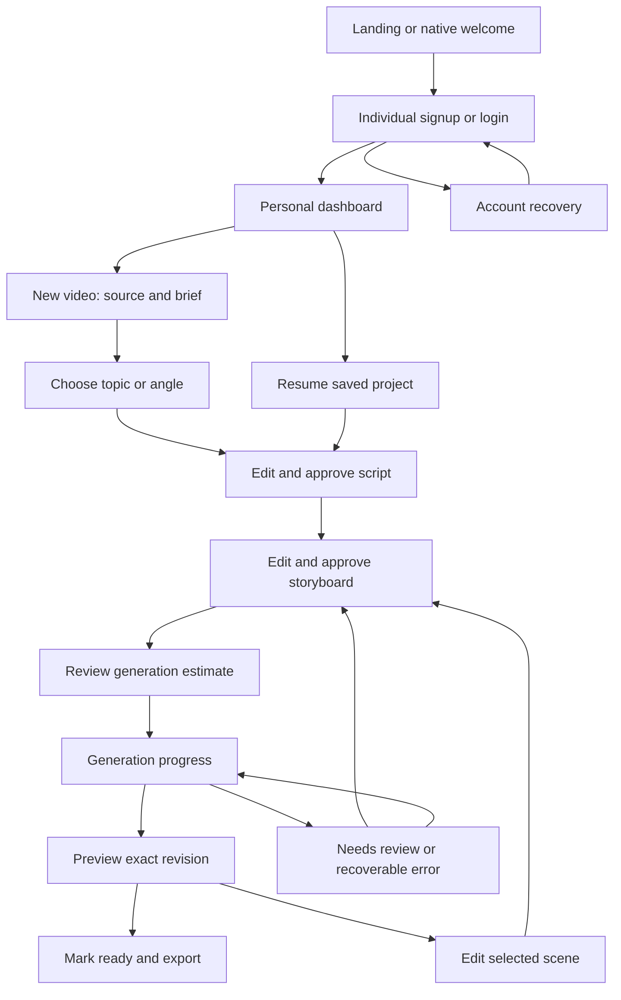

# V1 desktop, mobile web and native screen flows

Date: October 27, 2026.  
Status: Low-fidelity UX blueprint, not a running app or final visual design.  
Identity: each person has a private individual account; no team/organization setup in V1.

## 1. Main journey



Returning customers resume the appropriate saved stage. Direct script input may skip idea generation. “Approve script” and “Approve storyboard” are separate from a potentially billable generation action. Returning to review an existing artifact never starts paid generation automatically.

## 2. Screen inventory

| ID | Screen | Primary action | Required context/states |
|---|---|---|---|
| S01 | Welcome / sign-in / signup | Sign in or create individual account | No group/company name required; recovery, invalid session, loading and error |
| S02 | Personal setup | Save audience/tone and optional brand | Skippable brand defaults; timezone/language; no invite step |
| S03 | Dashboard / projects | Create video or resume project | Empty, draft, queued, rendering, ready, needs attention, archived |
| S04 | Source and brief | Continue to ideas/script | Topic/pasted text/pasted script; URL supported when implemented; audience, goal, duration, rights confirmation for uploads |
| S05 | Ideas | Select or edit an idea | Distinct angles and learning outcomes; editable own idea; explicit regeneration |
| S06 | Script review | Approve this script revision | Narration, source references, estimated duration, review flags, save state |
| S07 | Storyboard / scene editor | Approve storyboard or update preview | Scene list, narration/text, template and visual controls, source link, move up/down, duplicate/delete |
| S08 | Generation estimate | Confirm generation | Operation/revision, estimated usage, balance, maximum, effect of retries, cancel/back |
| S09 | Production progress | Return later or inspect attention state | Real stage, completed work, duration so far, cancel intent, reconnect; no invented ETA |
| S10 | Preview / scene revision | Mark ready or edit scene | Player, current revision, preview freshness, caption toggle, defect report and scene navigation |
| S11 | Export / versions | Download or save/share | Exact output version, runtime/format, caption file, historical exports, secure-link expiry recovery |
| S12 | Brand / account / usage | Save settings or inspect usage | Private preferences, generation history, remaining units, account recovery/deletion |
| S13 | Billing (R2) | Purchase/manage permitted plan | Web checkout or platform-specific native flow; restores, pending purchase, failed payment |
| S14 | Connections / calendar (R3) | Approve and schedule | Exact destination identity, timezone, artifact/metadata, status and reconnection |
| S15 | Recurring plans (R4) | Review and enable bounded plan | Default review-first, budget, cadence, pause, notifications and per-run status |

S14/S15 preserve the original V1 roadmap; they are not required for the first 30-second technical proof. Agency dashboards, team roles and external client review belong to V2.

## 3. Desktop studio wireframe

```text
+----------------------------------------------------------------------------------+
| Video Studio       Project title        Saved / Saving / Needs attention   Profile |
| Source  >  Script  >  Storyboard  >  Preview  >  Export                             |
+--------------------+-------------------------------------+-----------------------+
| SCENES             | PREVIEW                             | SELECTED SCENE        |
| 01 Hook            |                                     | Narration             |
| 02 Name result     |          Vertical video             | [editable text]       |
| 03 Break into steps|          or scene preview           |                       |
| 04 Next action     |                                     | On-screen wording     |
| 05 Recap           |                                     | [editable text]       |
|                    |                                     | Template / voice      |
| Move up / down     | Play / pause / seek                 | Source references     |
+--------------------+-------------------------------------+-----------------------+
| Preview reflects revision 3. Your latest edit is revision 4.                      |
| [Back]                         [Review changes]          [Update preview]          |
+----------------------------------------------------------------------------------+
```

The diagram is structural. In narrow layouts, preview and editor become separate tabs or stacked sections; no critical control disappears. An earlier output is labelled as earlier, not removed.

## 4. Mobile creation wireframe

```text
+--------------------------------+
| < Project title         Saved  |
| Step 3 of 5: Storyboard        |
+--------------------------------+
| [Preview] [Scenes] [Details]    |
|                                |
|      Scene 2 of 5              |
|      vertical preview          |
|      [Play scene]              |
|                                |
| Name the result                |
| Narration                      |
| [large editable text area]     |
|                                |
| [View source] [Change layout]  |
| [Move up] [Move down]          |
| [Previous scene] [Next scene]  |
+--------------------------------+
| [Back]      [Review storyboard]|
+--------------------------------+
```

Keep focused fields visible above the keyboard, respect device safe areas, preserve the local draft during network interruptions, and expose a clear save error/retry. Sticky action bars must not cover caption/text inputs. Reordering uses explicit buttons as well as optional drag gestures.

## 5. Platform adaptations

| Interaction | Desktop web | Mobile web | Android/iOS |
|---|---|---|---|
| Sources | Paste/upload panel | Phone-friendly paste/file picker | Native file/photo picker where supported |
| Scene review | List + preview + controls | One scene at a time with tabs | Native scene cards and touch controls |
| Preview | Interactive where possible; rendered authoritative export | Lightweight video fallback | Rendered preview first; label revision and refresh state |
| Progress | Dashboard updates/polling | Survives navigation/tab closure | Fetch on foreground; optional later push |
| Export | Authorized download | Device/browser-compatible save/share | Download to permitted location and native share sheet |
| Login | Individual web session | Same account | Same individual via native session and app redirects |
| Purchase | Web payment provider | Web payment provider | Permitted store-specific purchase UI; no naive embedded web checkout |

Native component reuse is not assumed. Share wording, design tokens, contracts and product behavior while validating platform media and keyboard behavior independently.

## 6. Approval and cost interaction

Generation confirmation must answer:

- Which revision will be produced?
- What will be generated or reused?
- What is the estimated usage and permitted maximum?
- What happens if a provider fails or the user cancels?
- Can the person return later without losing work?

Use a clear primary action such as “Generate video — estimated 120 test units” only in test mode. Replace with validated customer units/prices when billing is implemented. Avoid “free” for operations that consume credits and avoid promising a guaranteed result/time before measurement.

After an edit, show affected work, e.g. “Update narration for scene 3 and refresh video; other scene audio will be reused.” Do not claim a single-scene final encode when the whole MP4 must be reassembled.

## 7. Recovery flows

| State | Message/action behavior | Preserved work |
|---|---|---|
| Save/network failure | Show unsaved state; retry; preserve local text; never claim saved | Last server revision plus clearly labelled local draft |
| Another device changed project | Compare latest revision and reapply local edits | Both versions; no silent overwrite |
| Narration too long | Show measured duration; offer script/timing review | Script, storyboard and completed audio |
| Caption uncertainty | Review wording/timing before final render | Voice and draft alignment |
| Temporary provider failure | Show stage, retry state and cost treatment | Completed artifacts |
| Uncertain billed request | Explain status needs reconciliation; do not encourage repeated Generate taps | Request ID, usage uncertainty and existing assets |
| Old render completes | Label it with its revision; current draft still needs update | Earlier ready output |
| Expired download URL | Obtain a newly authorized link | Stored artifact; no new generation |
| Insufficient credits | Show required/available units and permitted next action | Entire project; do not start job |
| Cancellation requested | Show stopping/finished outcome accurately | Completed work according to retention rules |

## 8. Usability checks before visual polish

1. A new individual can enter without creating a team.
2. A first-time user can explain the next action and whether it consumes credits.
3. Source material and uncertain claims are easy to inspect during script/storyboard review.
4. Core creation completes on a narrow phone viewport using keyboard/touch alone.
5. A scene edit never makes an old preview appear up to date.
6. Refresh/resume returns the real persisted job state.
7. Earlier exports can be distinguished from the current draft.
8. Recovery guidance tells the user what to do without exposing backend jargon.

Brand name, final palette, logo and polished screen designs remain later design decisions. These low-fidelity flows define behavior and information priority first.
